<!-- repo-map:no-verification -->
<!-- GENERATED FILE -- do not edit by hand.
     Regenerate with `repo-tools map`. -->

# @danielsimonjr/sciengjs - Dependency Graph

**Version**: 0.2.0

This document provides a comprehensive dependency graph of all files, components, imports, functions, and variables in the codebase.

---

## Table of Contents

1. [Overview](#overview)
2. [Package Dependencies](#package-dependencies)
3. [Root Dependencies](#root-dependencies)
4. [Browser Dependencies](#browser-dependencies)
5. [Graph Dependencies](#graph-dependencies)
6. [Entry Dependencies](#entry-dependencies)
7. [Mermaid Dependencies](#mermaid-dependencies)
8. [Raster Dependencies](#raster-dependencies)
9. [Worker Dependencies](#worker-dependencies)
10. [Trials/t1 graph Dependencies](#trials-t1-graph-dependencies)
11. [Trials/t2 mesh Dependencies](#trials-t2-mesh-dependencies)
12. [Trials/t3 tex Dependencies](#trials-t3-tex-dependencies)
13. [Trials/t4 browser Dependencies](#trials-t4-browser-dependencies)
14. [Trials/t5 tex build Dependencies](#trials-t5-tex-build-dependencies)
15. [Trials/t6 etex build Dependencies](#trials-t6-etex-build-dependencies)
16. [Dependency Matrix](#dependency-matrix)
17. [Circular Dependency Analysis](#circular-dependency-analysis)
18. [Visual Dependency Graph](#visual-dependency-graph)
19. [Summary Statistics](#summary-statistics)

---

<a id="overview"></a>
## Overview

The codebase is organized into the following modules:

- **root**: 8 files
- **browser**: 11 files
- **graph**: 6 files
- **entry**: 1 file
- **mermaid**: 11 files
- **raster**: 2 files
- **worker**: 3 files
- **trials/t1-graph**: 3 files
- **trials/t2-mesh**: 1 file
- **trials/t3-tex**: 1 file
- **trials/t4-browser**: 2 files
- **trials/t5-tex-build**: 6 files
- **trials/t6-etex-build**: 1 file

---

<a id="root-dependencies"></a>

## Root Dependencies

### `src/assets.ts` - assets module

**Node.js Built-in Dependencies:**
| Module | Import |
|--------|--------|
| `fs` | `readFileSync` |
| `url` | `fileURLToPath` |

**Internal Dependencies:**
| File | Imports | Type |
|------|---------|------|
| `./errors.ts` | `RenderError` | Import |

**Exports:**
- Functions: `checkAssetsUrl`, `assetFile`, `bundledFontPathIn`, `readAsset`
- Constants: `BUNDLED_FONT_FILE`, `RESVG_WASM_FILE`

---

### `src/config.ts` - Resolves the configuration. Precedence: call option, then environment, then file, then default.

**Node.js Built-in Dependencies:**
| Module | Import |
|--------|--------|
| `os` | `homedir` |
| `fs/promises` | `readFile` |
| `path` | `default` |

**Internal Dependencies:**
| File | Imports | Type |
|------|---------|------|
| `./errors.ts` | `RenderError` | Import |
| `./version.ts` | `ENGINE_VERSION` | Import |
| `./assets.ts` | `checkAssetsUrl` | Import |

**Exports:**
- Interfaces: `SciengConfig`, `ConfigDeps`
- Types: `NetworkPolicy`
- Functions: `loadConfig`
- Constants: `DEFAULT_ASSETS_URL`

---

### `src/core.ts` - Renders one request. The registry and the config dependencies are parameters so that tests

**Internal Dependencies:**
| File | Imports | Type |
|------|---------|------|
| `./config.ts` | `loadConfig, ConfigDeps, SciengConfig` | Import |
| `./errors.ts` | `RenderError` | Import |
| `./pairs.ts` | `PAIRS, findPair` | Import |
| `./registry.ts` | `registryKey, Registry` | Import |
| `./worker/run.ts` | `runInWorker` | Import |
| `./types.ts` | `BINARY_INPUT_TYPES, INPUT_TYPES, OUTPUT_FORMATS, Capability, OutputFormat, RenderOptions, RenderRequest, RenderResult` | Import |

**Exports:**
- Functions: `renderWithRegistry`, `capabilitiesWithRegistry`

---

### `src/errors.ts` - Whether the value is a render error, decided structurally instead of by class identity.

**Exports:**
- Classes: `RenderError`
- Interfaces: `RenderErrorPosition`
- Types: `RenderErrorCode`
- Functions: `isRenderError`
- Constants: `RENDER_ERROR_CODES`

---

### `src/pairs.ts` - pairs module

**Internal Dependencies:**
| File | Imports | Type |
|------|---------|------|
| `./types.ts` | `InputType, OutputFormat` | Import (type-only) |

**Exports:**
- Interfaces: `PairSpec`
- Functions: `findPair`
- Constants: `PAIRS`

---

### `src/registry.ts` - registry module

**Node.js Built-in Dependencies:**
| Module | Import |
|--------|--------|
| `path` | `extname` |
| `url` | `fileURLToPath` |

**Exports:**
- Interfaces: `BackendEntry`
- Types: `Registry`
- Functions: `registryKey`
- Constants: `DEFAULT_REGISTRY`

---

### `src/types.ts` - types module

**Exports:**
- Interfaces: `RenderRequest`, `RenderAsset`, `RenderResult`, `Capability`
- Types: `InputType`, `OutputFormat`, `RenderOptions`
- Constants: `INPUT_TYPES`, `OUTPUT_FORMATS`, `BINARY_INPUT_TYPES`

---

### `src/version.ts` - Generated by scripts/prepare-build.mjs from package.json. Do not edit this file by hand.

**Exports:**
- Constants: `ENGINE_VERSION`

---

<a id="browser-dependencies"></a>

## Browser Dependencies

### `src/browser/backend-pdf.ts` - backend-pdf module

**Internal Dependencies:**
| File | Imports | Type |
|------|---------|------|
| `../worker/protocol.ts` | `BackendOutput, WorkerJob` | Import (type-only) |
| `./input.ts` | `blockedWarnings, browserPathOf, htmlSource, parsePdfOptions` | Import |
| `./render.ts` | `renderHtmlPage` | Import |

**Exports:**
- Functions: `render`

---

### `src/browser/backend-png.ts` - backend-png module

**Internal Dependencies:**
| File | Imports | Type |
|------|---------|------|
| `../worker/protocol.ts` | `BackendOutput, WorkerJob` | Import (type-only) |
| `./input.ts` | `blockedWarnings, browserPathOf, htmlSource, parsePngOptions` | Import |
| `./render.ts` | `renderHtmlPage` | Import |

**Exports:**
- Functions: `render`

---

### `src/browser/cdp.ts` - Sends one request. A request with no reply before its deadline rejects with E_TIMEOUT, and its pending entry

**Internal Dependencies:**
| File | Imports | Type |
|------|---------|------|
| `../errors.ts` | `RenderError` | Import |

**Exports:**
- Classes: `CdpConnection`
- Interfaces: `CdpSocket`
- Functions: `connectCdp`

---

### `src/browser/flags.ts` - The flags of every browser start. Each flag closes one route off the host. The client never adds

**Exports:**
- Interfaces: `FlagInputs`
- Functions: `forcedBrowserFlags`

---

### `src/browser/index.ts` - Package entry point for browser (re-exports 10 symbols)

**Internal Dependencies:**
| File | Imports | Type |
|------|---------|------|
| `./cdp.ts` | `CdpConnection, CdpSocket` | Re-export |
| `./flags.ts` | `forcedBrowserFlags, FlagInputs` | Re-export |
| `./proxy.ts` | `startRefusingProxy, RefusingProxy` | Re-export |
| `./render.ts` | `renderHtmlPage, HtmlPageRequest, HtmlPageResult, HtmlFormat` | Re-export |

**Exports:**
- Re-exports:

  ```text
  CdpConnection, CdpSocket, forcedBrowserFlags, FlagInputs, startRefusingProxy, RefusingProxy,
  renderHtmlPage, HtmlPageRequest, HtmlPageResult, HtmlFormat
  ```


---

### `src/browser/input.ts` - Checks the options of html to png. An unknown key, a bad value, a side over MAX_SIDE, a scale over MAX_SCALE

**Internal Dependencies:**
| File | Imports | Type |
|------|---------|------|
| `../errors.ts` | `RenderError` | Import |

**Exports:**
- Interfaces: `PngOptions`
- Functions: `parsePngOptions`, `parsePdfOptions`, `htmlSource`, `browserPathOf`, `blockedWarnings`
- Constants: `DEFAULT_WIDTH`, `DEFAULT_HEIGHT`, `DEFAULT_SCALE`, `MAX_SIDE`, `MAX_SCALE`, `MAX_DEVICE_PIXELS`, `MAX_BLOCKED_WARNINGS`, `MAX_WARNING_URL_CHARS`

---

### `src/browser/page.ts` - A page that loads the pinned Mermaid build and renders one source. The result is stored in window.__sciengDone:

**Exports:**
- Functions: `scriptJson`, `svgPageHtml`, `mermaidPageHtml`

---

### `src/browser/pinned.ts` - pinned module

**Exports:**
- Interfaces: `PinnedAsset`
- Constants: `MERMAID_VERSION`, `MERMAID_FILE`, `MERMAID_CDN_URL`, `PINNED_ASSETS`

---

### `src/browser/profile.ts` - Removes the profile. A held file is retried until the deadline, a Date.now() time. Any other error, or a deadline with t

**Node.js Built-in Dependencies:**
| Module | Import |
|--------|--------|
| `fs` | `mkdtempSync, rmSync` |
| `os` | `tmpdir` |
| `path` | `join` |

**Internal Dependencies:**
| File | Imports | Type |
|------|---------|------|
| `../errors.ts` | `RenderError` | Import |

**Exports:**
- Functions: `makeProfile`, `removeProfile`
- Constants: `PROFILE_PREFIX`

---

### `src/browser/proxy.ts` - The host of an absolute URL, or of the authority of a CONNECT request ("host:port"). A value that is

**Node.js Built-in Dependencies:**
| Module | Import |
|--------|--------|
| `net` | `Server, Socket` |
| `events` | `once` |
| `http` | `IncomingMessage, ServerResponse` |
| `http` | `createServer` |

**Exports:**
- Interfaces: `RefusingProxy`
- Functions: `startRefusingProxy`

---

### `src/browser/render.ts` - The share of the render time that the page work may use. The rest is the budget for stopping the browser

**Node.js Built-in Dependencies:**
| Module | Import |
|--------|--------|
| `child_process` | `spawn, spawnSync, ChildProcess` |
| `fs` | `readFileSync, existsSync` |
| `path` | `join` |

**Internal Dependencies:**
| File | Imports | Type |
|------|---------|------|
| `../errors.ts` | `RenderError` | Import |
| `./cdp.ts` | `CdpConnection, connectCdp` | Import |
| `./flags.ts` | `forcedBrowserFlags` | Import |
| `./profile.ts` | `makeProfile, removeProfile` | Import |
| `./proxy.ts` | `startRefusingProxy, RefusingProxy` | Import |

**Exports:**
- Interfaces: `PinnedBytes`, `HtmlPageResult`
- Types: `HtmlFormat`, `HtmlPageRequest`
- Functions: `capturePage`, `renderHtmlPage`
- Constants: `PAGE_URL`

---

<a id="graph-dependencies"></a>

## Graph Dependencies

### `src/graph/backend-pdf.ts` - backend-pdf module

**Internal Dependencies:**
| File | Imports | Type |
|------|---------|------|
| `../errors.ts` | `RenderError` | Import |
| `../worker/protocol.ts` | `BackendOutput, WorkerJob` | Import (type-only) |
| `../mermaid/browser.ts` | `drawSvgToPdf` | Import |
| `./dot.ts` | `dotSourceText, dotToSvg` | Import |

**Exports:**
- Functions: `render`

---

### `src/graph/backend-png.ts` - Rasterizes one SVG document to PNG at scale 1. The font follows render: the rasterFont setting when set,

**Node.js Built-in Dependencies:**
| Module | Import |
|--------|--------|
| `fs` | `readFileSync` |

**Internal Dependencies:**
| File | Imports | Type |
|------|---------|------|
| `../errors.ts` | `RenderError` | Import |
| `../assets.ts` | `bundledFontPathIn` | Import |
| `../worker/protocol.ts` | `BackendOutput, WorkerJob` | Import (type-only) |
| `./dot.ts` | `dotSourceText, dotToSvg` | Import |
| `../raster/index.ts` | `isFontFile, svgToPng` | Import |
| `../raster/warnings.ts` | `rasterWarnings` | Import |

**Exports:**
- Functions: `render`, `renderPng`, `svgDocumentToPng`

---

### `src/graph/backend-svg.ts` - backend-svg module

**Internal Dependencies:**
| File | Imports | Type |
|------|---------|------|
| `../errors.ts` | `RenderError` | Import |
| `../worker/protocol.ts` | `BackendOutput, WorkerJob` | Import (type-only) |
| `./dot.ts` | `dotSourceText, dotToSvg` | Import |

**Exports:**
- Functions: `render`

---

### `src/graph/dot.ts` - dot module

**Internal Dependencies:**
| File | Imports | Type |
|------|---------|------|
| `../errors.ts` | `RenderError` | Import |
| `./image.ts` | `stripImageAttributes, dropImageElements, dropStylesheetInstructions` | Import |

**Exports:**
- Interfaces: `DotSvgResult`
- Functions: `dotToSvg`, `dotSourceText`

---

### `src/graph/image.ts` - DOT identifiers take every byte from 0x80 upward, so every non-ASCII character counts as a letter.

**Exports:**
- Interfaces: `ImageRemoval`, `StripResult`
- Functions: `stripImageAttributes`, `dropImageElements`, `dropStylesheetInstructions`

---

### `src/graph/index.ts` - Package entry point for graph (re-exports 2 symbols)

**Internal Dependencies:**
| File | Imports | Type |
|------|---------|------|
| `./dot.ts` | `dotToSvg` | Re-export |
| `./dot.ts` | `DotSvgResult` | Re-export (type-only) |

**Exports:**
- Re-exports: `dotToSvg`, `DotSvgResult`

---

<a id="entry-dependencies"></a>

## Entry Dependencies

### `src/index.ts` - Package entry point for src (re-exports 15 symbols)

**Internal Dependencies:**
| File | Imports | Type |
|------|---------|------|
| `./core.ts` | `capabilitiesWithRegistry, renderWithRegistry` | Import |
| `./registry.ts` | `DEFAULT_REGISTRY` | Import |
| `./config.ts` | `SciengConfig` | Import (type-only) |
| `./types.ts` | `Capability, RenderRequest, RenderResult` | Import (type-only) |
| `./errors.ts` | `RenderError, RENDER_ERROR_CODES, RenderErrorCode` | Re-export |
| `./config.ts` | `loadConfig, SciengConfig, NetworkPolicy` | Re-export |
| `./types.ts` | `INPUT_TYPES, OUTPUT_FORMATS, InputType, OutputFormat, RenderOptions, RenderRequest, RenderResult, RenderAsset, Capability` | Re-export |

**Exports:**
- Functions: `render`, `capabilities`
- Re-exports:

  ```text
  RenderError, RENDER_ERROR_CODES, RenderErrorCode, loadConfig, SciengConfig, NetworkPolicy,
  INPUT_TYPES, OUTPUT_FORMATS, InputType, OutputFormat, RenderOptions, RenderRequest, RenderResult,
  RenderAsset, Capability
  ```


---

<a id="mermaid-dependencies"></a>

## Mermaid Dependencies

### `src/mermaid/backend-pdf.ts` - Renders one Mermaid source to pdf in the browser stage. A native diagram is laid out first, then its SVG is

**Internal Dependencies:**
| File | Imports | Type |
|------|---------|------|
| `../worker/protocol.ts` | `BackendOutput, WorkerJob` | Import (type-only) |
| `./common.ts` | `readLenient, routesToBrowser, sourceText` | Import |
| `./browser.ts` | `drawMermaidInBrowser, drawSvgToPdf, MERMAID_NATIVE_PDF_BACKEND` | Import |
| `./render.ts` | `renderMermaidSvg` | Import |

**Exports:**
- Functions: `render`

---

### `src/mermaid/backend-png.ts` - Renders one Mermaid source to PNG. A native diagram is drawn to SVG and then to PNG by the raster stage.

**Internal Dependencies:**
| File | Imports | Type |
|------|---------|------|
| `../graph/backend-png.ts` | `svgDocumentToPng` | Import |
| `../worker/protocol.ts` | `BackendOutput, WorkerJob` | Import (type-only) |
| `./common.ts` | `readLenient, routesToBrowser, sourceText` | Import |
| `./browser.ts` | `drawMermaidInBrowser` | Import |
| `./render.ts` | `renderMermaidSvg` | Import |

**Exports:**
- Functions: `render`

---

### `src/mermaid/backend-svg.ts` - Renders one Mermaid source to SVG. A native diagram goes through the native layouts. Any other Mermaid type goes

**Internal Dependencies:**
| File | Imports | Type |
|------|---------|------|
| `../worker/protocol.ts` | `BackendOutput, WorkerJob` | Import (type-only) |
| `./common.ts` | `readLenient, routesToBrowser, sourceText` | Import |
| `./browser.ts` | `drawMermaidInBrowser` | Import |
| `./render.ts` | `renderMermaidSvg` | Import |

**Exports:**
- Functions: `render`

---

### `src/mermaid/browser.ts` - Draws one Mermaid source of a browser type through the browser stage. The page names the pinned Mermaid URL.

**Internal Dependencies:**
| File | Imports | Type |
|------|---------|------|
| `../browser/input.ts` | `blockedWarnings, browserPathOf` | Import |
| `../browser/pinned.ts` | `MERMAID_CDN_URL, MERMAID_FILE` | Import |
| `../browser/page.ts` | `mermaidPageHtml, svgPageHtml` | Import |
| `../browser/render.ts` | `renderHtmlPage, HtmlFormat, HtmlPageRequest, PinnedBytes` | Import |
| `../assets.ts` | `readAsset` | Import |

**Exports:**
- Interfaces: `BrowserSettings`, `BrowserDraw`
- Functions: `drawMermaidInBrowser`, `drawSvgToPdf`
- Constants: `MERMAID_BROWSER_BACKEND`, `MERMAID_NATIVE_PDF_BACKEND`

---

### `src/mermaid/class.ts` - class module

**Internal Dependencies:**
| File | Imports | Type |
|------|---------|------|
| `./common.ts` | `inputError, outside, xmlSafe, ContentLine, Source` | Import |

**Exports:**
- Interfaces: `ClassArrow`, `ClassDef`, `ClassRelation`, `ClassModel`
- Types: `Marker`
- Functions: `parseClassDiagram`, `classToDot`

---

### `src/mermaid/common.ts` - Reads the option `lenient` and checks the other keys. A key outside `lenient` and `extra` rejects with E_INPUT.

**Internal Dependencies:**
| File | Imports | Type |
|------|---------|------|
| `../errors.ts` | `RenderError` | Import |

**Exports:**
- Interfaces: `ContentLine`, `Context`, `Source`
- Types: `DiagramKind`
- Functions: `readLenient`, `sourceText`, `xmlSafe`, `inputError`, `outside`, `prepare`, `routesToBrowser`

---

### `src/mermaid/index.ts` - The public surface of the Mermaid native layouts. It holds the header and option reader, the parsers,

**Internal Dependencies:**
| File | Imports | Type |
|------|---------|------|
| `./common.ts` | `prepare, Source` | Re-export |
| `./class.ts` | `parseClassDiagram, classToDot, ClassModel, ClassDef, ClassRelation, ClassArrow, Marker` | Re-export |
| `./state.ts` | `parseStateDiagram, stateToDot, StateModel, StateDef, StateTransition` | Re-export |
| `./sequence.ts` | `parseSequenceDiagram, SequenceModel, SeqEvent, Participant, MessageEvent, NoteEvent, ActivateEvent, DeactivateEvent, Branch, BlockEvent` | Re-export |
| `./sequence-layout.ts` | `layoutSequence` | Re-export |
| `./render.ts` | `renderMermaidSvg, MermaidSvg` | Re-export |

**Exports:**
- Re-exports:

  ```text
  prepare, Source, parseClassDiagram, classToDot, ClassModel, ClassDef, ClassRelation, ClassArrow,
  Marker, parseStateDiagram, stateToDot, StateModel, StateDef, StateTransition, parseSequenceDiagram,
  SequenceModel, SeqEvent, Participant, MessageEvent, NoteEvent, ActivateEvent, DeactivateEvent,
  Branch, BlockEvent, layoutSequence, renderMermaidSvg, MermaidSvg
  ```


---

### `src/mermaid/render.ts` - Renders one Mermaid source to SVG. A class or state diagram goes through DOT and the graph stage.

**Internal Dependencies:**
| File | Imports | Type |
|------|---------|------|
| `../graph/dot.ts` | `dotToSvg` | Import |
| `./class.ts` | `classToDot, parseClassDiagram` | Import |
| `./common.ts` | `prepare` | Import |
| `./sequence.ts` | `parseSequenceDiagram` | Import |
| `./sequence-layout.ts` | `layoutSequence` | Import |
| `./state.ts` | `parseStateDiagram, stateToDot` | Import |

**Exports:**
- Interfaces: `MermaidSvg`
- Functions: `renderMermaidSvg`

---

### `src/mermaid/sequence-layout.ts` - Lays out one sequence model into one SVG document string.

**Internal Dependencies:**
| File | Imports | Type |
|------|---------|------|
| `./common.ts` | `xmlSafe` | Import |
| `./sequence.ts` | `BlockEvent, Branch, MessageEvent, SeqEvent, SequenceModel` | Import (type-only) |

**Exports:**
- Functions: `layoutSequence`

---

### `src/mermaid/sequence.ts` - sequence module

**Internal Dependencies:**
| File | Imports | Type |
|------|---------|------|
| `./common.ts` | `inputError, outside, Source` | Import |

**Exports:**
- Interfaces: `Participant`, `MessageEvent`, `NoteEvent`, `ActivateEvent`, `DeactivateEvent`, `Branch`, `BlockEvent`, `SequenceModel`
- Types: `SeqEvent`
- Functions: `parseSequenceDiagram`

---

### `src/mermaid/state.ts` - state module

**Internal Dependencies:**
| File | Imports | Type |
|------|---------|------|
| `./common.ts` | `inputError, outside, xmlSafe, ContentLine, Source` | Import |

**Exports:**
- Interfaces: `StateDef`, `StateTransition`, `StateModel`
- Functions: `parseStateDiagram`, `stateToDot`

---

<a id="raster-dependencies"></a>

## Raster Dependencies

### `src/raster/index.ts` - The most megabytes of RGBA pixels that one PNG render accepts. Measured: a render holds about two

**External Dependencies:**
| Package | Import |
|---------|--------|
| `@resvg/resvg-wasm` | `initWasm, Resvg` |

**Internal Dependencies:**
| File | Imports | Type |
|------|---------|------|
| `../assets.ts` | `readAsset, RESVG_WASM_FILE` | Import |
| `../config.ts` | `DEFAULT_ASSETS_URL` | Import |
| `../errors.ts` | `RenderError` | Import |

**Exports:**
- Interfaces: `SvgToPngOptions`
- Functions: `svgToPng`, `isFontFile`
- Constants: `MAX_PNG_PIXEL_MB`

---

### `src/raster/warnings.ts` - Reads the Unicode character map of a TrueType or OpenType font (formats 4 and 12).

**Exports:**
- Types: `CoverageTest`
- Functions: `fontCovers`, `rasterWarnings`

---

<a id="worker-dependencies"></a>

## Worker Dependencies

### `src/worker/entry.ts` - The worker side of a render. The worker loads the backend module, runs one request and posts one message.

**Node.js Built-in Dependencies:**
| Module | Import |
|--------|--------|
| `worker_threads` | `parentPort, workerData` |

**Internal Dependencies:**
| File | Imports | Type |
|------|---------|------|
| `../errors.ts` | `RenderError, RENDER_ERROR_CODES, isRenderError, RenderErrorCode` | Import |
| `./protocol.ts` | `BackendOutput, WorkerJob, WorkerMessage` | Import (type-only) |

---

### `src/worker/protocol.ts` - Type definitions (3 interfaces, 1 type aliases)

**Internal Dependencies:**
| File | Imports | Type |
|------|---------|------|
| `../types.ts` | `InputType, OutputFormat, RenderOptions` | Import (type-only) |

**Exports:**
- Interfaces: `BackendSettings`, `WorkerJob`, `BackendOutput`
- Types: `WorkerMessage`

---

### `src/worker/run.ts` - The heap limit of the worker, in megabytes. Node enforces it. Bun 1.4.4 accepts the option

**Node.js Built-in Dependencies:**
| Module | Import |
|--------|--------|
| `worker_threads` | `Worker` |
| `path` | `extname` |
| `url` | `fileURLToPath` |

**Internal Dependencies:**
| File | Imports | Type |
|------|---------|------|
| `../errors.ts` | `RenderError` | Import |
| `./protocol.ts` | `BackendOutput, WorkerJob, WorkerMessage` | Import (type-only) |

**Exports:**
- Interfaces: `WorkerExit`, `WorkerLimits`
- Functions: `runInWorker`

---

<a id="trials-t1-graph-dependencies"></a>

## Trials/t1 graph Dependencies

### `trials/t1-graph/compare-layout.mjs` - Trial T1: compare the node layout of two Graphviz SVG files of the same DOT source.

**Node.js Built-in Dependencies:**
| Module | Import |
|--------|--------|
| `fs` | `readFileSync` |

---

### `trials/t1-graph/make-sources.mjs` - Writes the generated DOT sources of trial T1. The measurement script and the

**Node.js Built-in Dependencies:**
| Module | Import |
|--------|--------|
| `fs` | `writeFileSync` |
| `path` | `dirname, join` |
| `url` | `fileURLToPath` |

---

### `trials/t1-graph/measure.mjs` - Trial T1: measure @viz-js/viz on Bun or Node. Runs unchanged under both.

**Node.js Built-in Dependencies:**
| Module | Import |
|--------|--------|
| `crypto` | `createHash` |
| `fs` | `existsSync, mkdirSync, readFileSync, readdirSync, statSync, writeFileSync` |
| `path` | `dirname, join` |
| `url` | `fileURLToPath` |

---

<a id="trials-t2-mesh-dependencies"></a>

## Trials/t2 mesh Dependencies

### `trials/t2-mesh/measure.mjs` - Trial T2: measure occt-import-js on Bun or Node. Runs unchanged under both.

**Node.js Built-in Dependencies:**
| Module | Import |
|--------|--------|
| `crypto` | `createHash` |
| `fs` | `readFileSync, readdirSync, statSync` |
| `path` | `dirname, join` |
| `url` | `fileURLToPath` |

---

<a id="trials-t3-tex-dependencies"></a>

## Trials/t3 tex Dependencies

### `trials/t3-tex/shim/index.cjs` - Stand-in for the node-kpathsea addon that web2js library.js requires.

---

<a id="trials-t4-browser-dependencies"></a>

## Trials/t4 browser Dependencies

### `trials/t4-browser/assets/pinned.js` - The local copy of the pinned asset. The client serves it for the pinned URL in config.json.

---

### `trials/t4-browser/measure.mjs` - A proxy that refuses every connection. It records each attempt (the first line of the request)

**Node.js Built-in Dependencies:**
| Module | Import |
|--------|--------|
| `child_process` | `spawn` |
| `net` | `createServer` |
| `fs` | `existsSync, mkdirSync, mkdtempSync, readFileSync, rmSync, writeFileSync, appendFileSync` |
| `os` | `arch, platform, release, tmpdir` |
| `path` | `dirname, join` |
| `url` | `fileURLToPath` |
| `zlib` | `inflateSync` |

---

<a id="trials-t5-tex-build-dependencies"></a>

## Trials/t5 tex build Dependencies

### `trials/t5-tex-build/runtime/dvi2svg.mjs` - a font with no PFB keeps its TFM advances, and each of its glyphs goes in the missing list

**Internal Dependencies:**
| File | Imports | Type |
|------|---------|------|
| `./tfm.mjs` | `readTfm` | Import |
| `./type1.mjs` | `readType1` | Import |

**Exports:**
- Functions: `dviToSvg`

---

### `trials/t5-tex-build/runtime/host.mjs` - Host functions of the T5 trial: the Pascal file model on a virtual file system.

**Exports:**
- Classes: `ExitSignal`, `Host`

---

### `trials/t5-tex-build/runtime/run.mjs` - Run one compiled Pascal program on the virtual file system.

**Internal Dependencies:**
| File | Imports | Type |
|------|---------|------|
| `./host.mjs` | `Host, ExitSignal` | Import |

**Exports:**
- Functions: `runProgram`

---

### `trials/t5-tex-build/runtime/tfm.mjs` - TFM reader of the trial: the character widths and the design size.

**Exports:**
- Functions: `readTfm`

---

### `trials/t5-tex-build/runtime/type1.mjs` - Type 1 font reader of the trial: PFB (or PFA) to SVG path data for each glyph.

**Exports:**
- Functions: `readType1`

---

### `trials/t5-tex-build/runtime/vfs.mjs` - A virtual file system for the TeX runs of the trial. Reads come from an

**Node.js Built-in Dependencies:**
| Module | Import |
|--------|--------|
| `fs` | `default` |
| `path` | `default` |

**Exports:**
- Classes: `TreeFS`
- Constants: `flatName`

---

<a id="trials-t6-etex-build-dependencies"></a>

## Trials/t6 etex build Dependencies

### `trials/t6-etex-build/runtime/dvisvgm-specials.mjs` - The SVG unit of the specials of dvisvgm: the big point (72 bp = 72.27 pt).

**Exports:**
- Functions: `createSpecials`
- Constants: `unitPerPt`

---

<a id="dependency-matrix"></a>
## Dependency Matrix

### File Import/Export Matrix

| File | Imports From | Exports To |
|------|--------------|------------|
| `src/errors` | 0 files | 16 files |
| `src/worker/protocol` | 1 file | 10 files |
| `src/mermaid/common` | 1 file | 9 files |
| `src/mermaid/render` | 6 files | 4 files |
| `src/browser/render` | 5 files | 4 files |
| `src/mermaid/browser` | 5 files | 4 files |
| `src/core` | 6 files | 1 file |
| `src/graph/backend-png` | 6 files | 1 file |
| `src/graph/dot` | 2 files | 5 files |
| `src/config` | 3 files | 3 files |
| `src/mermaid/index` | 6 files | 0 files |
| `src/assets` | 1 file | 4 files |
| `src/index` | 5 files | 0 files |
| `src/mermaid/backend-png` | 5 files | 0 files |
| `src/browser/index` | 4 files | 0 files |
| `src/browser/input` | 1 file | 3 files |
| `src/graph/backend-pdf` | 4 files | 0 files |
| `src/mermaid/backend-pdf` | 4 files | 0 files |
| `src/mermaid/backend-svg` | 4 files | 0 files |
| `src/mermaid/sequence-layout` | 2 files | 2 files |
| `src/mermaid/sequence` | 1 file | 3 files |
| `src/raster/index` | 3 files | 1 file |
| `src/types` | 0 files | 4 files |
| `src/browser/backend-pdf` | 3 files | 0 files |
| `src/browser/backend-png` | 3 files | 0 files |
| `src/browser/cdp` | 1 file | 2 files |
| `src/graph/backend-svg` | 3 files | 0 files |
| `src/mermaid/class` | 1 file | 2 files |
| `src/mermaid/state` | 1 file | 2 files |
| `src/worker/run` | 2 files | 1 file |
| `src/browser/flags` | 0 files | 2 files |
| `src/browser/profile` | 1 file | 1 file |
| `src/browser/proxy` | 0 files | 2 files |
| `src/pairs` | 1 file | 1 file |
| `src/registry` | 0 files | 2 files |
| `src/worker/entry` | 2 files | 0 files |
| `trials/t5-tex-build/runtime/dvi2svg.mjs` | 2 files | 0 files |
| `src/browser/page` | 0 files | 1 file |
| `src/browser/pinned` | 0 files | 1 file |
| `src/graph/image` | 0 files | 1 file |

---

<a id="circular-dependency-analysis"></a>
## Circular Dependency Analysis

**No circular dependencies detected.**
---

<a id="visual-dependency-graph"></a>
## Visual Dependency Graph

```mermaid
graph TD
    subgraph Root
        N0[assets]
        N1[config]
        N2[core]
        N3[errors]
        N4[pairs]
        N5[registry]
        N6[types]
        N7[version]
    end

    subgraph Browser
        N8[backend-pdf]
        N9[backend-png]
        N10[cdp]
        N11[flags]
        N12[index]
        N13[input]
        N14[page]
        N15[pinned]
        N16[profile]
        N17[proxy]
        N18[...1 more]
    end

    subgraph Graph
        N19[backend-pdf]
        N20[backend-png]
        N21[backend-svg]
        N22[dot]
        N23[image]
        N24[index]
    end

    subgraph Entry
        N25[index]
    end

    subgraph Mermaid
        N26[backend-pdf]
        N27[backend-png]
        N28[backend-svg]
        N29[browser]
        N30[class]
        N31[common]
        N32[index]
        N33[render]
        N34[sequence-layout]
        N35[sequence]
        N36[...1 more]
    end

    subgraph Raster
        N37[index]
        N38[warnings]
    end

    subgraph Worker
        N39[entry]
        N40[protocol]
        N41[run]
    end

    subgraph Trials/t1-graph
        N42[compare-layout.mjs]
        N43[make-sources.mjs]
        N44[measure.mjs]
    end

    subgraph Trials/t2-mesh
        N45[measure.mjs]
    end

    subgraph Trials/t3-tex
        N46[index.cjs]
    end

    subgraph Trials/t4-browser
        N47[pinned.js]
        N48[measure.mjs]
    end

    subgraph Trials/t5-tex-build
        N49[dvi2svg.mjs]
        N50[host.mjs]
        N51[run.mjs]
        N52[tfm.mjs]
        N53[type1.mjs]
        N54[vfs.mjs]
    end

    subgraph Trials/t6-etex-build
        N55[dvisvgm-specials.mjs]
    end

    N0 --> N3
    N8 --> N40
    N8 --> N13
    N9 --> N40
    N9 --> N13
    N10 --> N3
    N12 --> N10
    N12 --> N11
    N12 --> N17
    N13 --> N3
    N16 --> N3
    N1 --> N3
    N1 --> N7
    N1 --> N0
    N2 --> N1
    N2 --> N3
    N2 --> N4
    N2 --> N5
    N2 --> N41
    N2 --> N6
    N19 --> N3
    N19 --> N40
    N19 --> N29
    N19 --> N22
    N20 --> N3
    N20 --> N0
    N20 --> N40
    N20 --> N22
    N20 --> N37
    N20 --> N38
    N21 --> N3
    N21 --> N40
    N21 --> N22
    N22 --> N3
    N22 --> N23
    N24 --> N22
    N25 --> N2
    N25 --> N5
    N25 --> N1
    N25 --> N6
    N25 --> N3
    N26 --> N40
    N26 --> N31
    N26 --> N29
    N26 --> N33
    N27 --> N20
    N27 --> N40
    N27 --> N31
    N27 --> N29
    N27 --> N33
    N28 --> N40
    N28 --> N31
    N28 --> N29
    N28 --> N33
    N29 --> N13
    N29 --> N15
    N29 --> N14
    N29 --> N0
    N30 --> N31
    N31 --> N3
    N32 --> N31
    N32 --> N30
    N32 --> N35
    N32 --> N34
    N32 --> N33
    N33 --> N22
    N33 --> N30
    N33 --> N31
    N33 --> N35
    N33 --> N34
    N34 --> N31
    N34 --> N35
    N35 --> N31
    N4 --> N6
    N37 --> N0
```



---

<a id="summary-statistics"></a>
## Summary Statistics

| Category | Count |
|----------|-------|
| Total Source Files | 157 |
| Subsystems | 13 |
| Total Lines of Code | 17006 |
| Total Exports | 305 |
| Total Re-exports | 55 |
| Total Classes | 6 |
| Total Interfaces | 51 |
| Total Functions | 131 |
| Total Type Guards | 2 |
| Total Enums | 0 |
| Type-only Imports | 23 |
| Runtime Cyclic Components | 0 |
| Type-only Cyclic Components | 0 |
| Files in Runtime Cycles | 0 |
| Files in Type-only Cycles | 0 |

---

*Version*: 0.2.0
