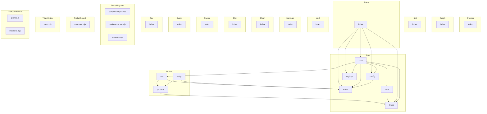

<!-- repo-map:no-verification -->
<!-- GENERATED FILE -- do not edit by hand.
     Regenerate with `repo-tools map`. -->

# @danielsimonjr/sciengjs - Dependency Graph

**Version**: 0.0.0

This document provides a comprehensive dependency graph of all files, components, imports, functions, and variables in the codebase.

---

## Table of Contents

1. [Overview](#overview)
2. [Package Dependencies](#package-dependencies)
3. [Browser Dependencies](#browser-dependencies)
4. [Root Dependencies](#root-dependencies)
5. [Graph Dependencies](#graph-dependencies)
6. [Html Dependencies](#html-dependencies)
7. [Entry Dependencies](#entry-dependencies)
8. [Math Dependencies](#math-dependencies)
9. [Mermaid Dependencies](#mermaid-dependencies)
10. [Mesh Dependencies](#mesh-dependencies)
11. [Plot Dependencies](#plot-dependencies)
12. [Raster Dependencies](#raster-dependencies)
13. [Sysml Dependencies](#sysml-dependencies)
14. [Tex Dependencies](#tex-dependencies)
15. [Worker Dependencies](#worker-dependencies)
16. [Trials/t1 graph Dependencies](#trials-t1-graph-dependencies)
17. [Trials/t2 mesh Dependencies](#trials-t2-mesh-dependencies)
18. [Trials/t3 tex Dependencies](#trials-t3-tex-dependencies)
19. [Trials/t4 browser Dependencies](#trials-t4-browser-dependencies)
20. [Dependency Matrix](#dependency-matrix)
21. [Circular Dependency Analysis](#circular-dependency-analysis)
22. [Visual Dependency Graph](#visual-dependency-graph)
23. [Summary Statistics](#summary-statistics)

---

<a id="overview"></a>
## Overview

The codebase is organized into the following modules:

- **browser**: 1 file
- **root**: 6 files
- **graph**: 1 file
- **html**: 1 file
- **entry**: 1 file
- **math**: 1 file
- **mermaid**: 1 file
- **mesh**: 1 file
- **plot**: 1 file
- **raster**: 1 file
- **sysml**: 1 file
- **tex**: 1 file
- **worker**: 3 files
- **trials/t1-graph**: 3 files
- **trials/t2-mesh**: 1 file
- **trials/t3-tex**: 1 file
- **trials/t4-browser**: 2 files

---

<a id="browser-dependencies"></a>

## Browser Dependencies

### `src/browser/index.ts` - Package entry point

---

<a id="root-dependencies"></a>

## Root Dependencies

### `src/config.ts` - Resolves the configuration. Precedence: call option, then environment, then file, then default.

**Node.js Built-in Dependencies:**
| Module | Import |
|--------|--------|
| `os` | `homedir` |
| `fs/promises` | `readFile` |
| `path` | `default` |

**Internal Dependencies:**
| File | Imports | Type |
|------|---------|------|
| `./errors.ts` | `RenderError` | Import |

**Exports:**
- Interfaces: `SciengConfig`, `ConfigDeps`
- Types: `NetworkPolicy`
- Functions: `loadConfig`

---

### `src/core.ts` - Renders one request. The registry and the config dependencies are parameters so that tests

**Internal Dependencies:**
| File | Imports | Type |
|------|---------|------|
| `./config.ts` | `loadConfig, ConfigDeps, SciengConfig` | Import |
| `./errors.ts` | `RenderError` | Import |
| `./pairs.ts` | `PAIRS, findPair` | Import |
| `./registry.ts` | `registryKey, Registry` | Import |
| `./worker/run.ts` | `runInWorker` | Import |
| `./types.ts` | `BINARY_INPUT_TYPES, INPUT_TYPES, OUTPUT_FORMATS, Capability, OutputFormat, RenderOptions, RenderRequest, RenderResult` | Import |

**Exports:**
- Functions: `renderWithRegistry`, `capabilitiesWithRegistry`

---

### `src/errors.ts` - errors module

**Exports:**
- Classes: `RenderError`
- Interfaces: `RenderErrorPosition`
- Types: `RenderErrorCode`
- Constants: `RENDER_ERROR_CODES`

---

### `src/pairs.ts` - pairs module

**Internal Dependencies:**
| File | Imports | Type |
|------|---------|------|
| `./types.ts` | `InputType, OutputFormat` | Import (type-only) |

**Exports:**
- Interfaces: `PairSpec`
- Functions: `findPair`
- Constants: `PAIRS`

---

### `src/registry.ts` - registry module

**Exports:**
- Interfaces: `BackendEntry`
- Types: `Registry`
- Functions: `registryKey`
- Constants: `DEFAULT_REGISTRY`

---

### `src/types.ts` - types module

**Exports:**
- Interfaces: `RenderRequest`, `RenderAsset`, `RenderResult`, `Capability`
- Types: `InputType`, `OutputFormat`, `RenderOptions`
- Constants: `INPUT_TYPES`, `OUTPUT_FORMATS`, `BINARY_INPUT_TYPES`

---

<a id="graph-dependencies"></a>

## Graph Dependencies

### `src/graph/index.ts` - Package entry point

---

<a id="html-dependencies"></a>

## Html Dependencies

### `src/html/index.ts` - Package entry point

---

<a id="entry-dependencies"></a>

## Entry Dependencies

### `src/index.ts` - Package entry point for src (re-exports 15 symbols)

**Internal Dependencies:**
| File | Imports | Type |
|------|---------|------|
| `./core.ts` | `capabilitiesWithRegistry, renderWithRegistry` | Import |
| `./registry.ts` | `DEFAULT_REGISTRY` | Import |
| `./config.ts` | `SciengConfig` | Import (type-only) |
| `./types.ts` | `Capability, RenderRequest, RenderResult` | Import (type-only) |
| `./errors.ts` | `RenderError, RENDER_ERROR_CODES, RenderErrorCode` | Re-export |
| `./config.ts` | `loadConfig, SciengConfig, NetworkPolicy` | Re-export |
| `./types.ts` | `INPUT_TYPES, OUTPUT_FORMATS, InputType, OutputFormat, RenderOptions, RenderRequest, RenderResult, RenderAsset, Capability` | Re-export |

**Exports:**
- Functions: `render`, `capabilities`
- Re-exports:

  ```text
  RenderError, RENDER_ERROR_CODES, RenderErrorCode, loadConfig, SciengConfig, NetworkPolicy,
  INPUT_TYPES, OUTPUT_FORMATS, InputType, OutputFormat, RenderOptions, RenderRequest, RenderResult,
  RenderAsset, Capability
  ```


---

<a id="math-dependencies"></a>

## Math Dependencies

### `src/math/index.ts` - Package entry point

---

<a id="mermaid-dependencies"></a>

## Mermaid Dependencies

### `src/mermaid/index.ts` - Package entry point

---

<a id="mesh-dependencies"></a>

## Mesh Dependencies

### `src/mesh/index.ts` - Package entry point

---

<a id="plot-dependencies"></a>

## Plot Dependencies

### `src/plot/index.ts` - Package entry point

---

<a id="raster-dependencies"></a>

## Raster Dependencies

### `src/raster/index.ts` - Package entry point

---

<a id="sysml-dependencies"></a>

## Sysml Dependencies

### `src/sysml/index.ts` - Package entry point

---

<a id="tex-dependencies"></a>

## Tex Dependencies

### `src/tex/index.ts` - Package entry point

---

<a id="worker-dependencies"></a>

## Worker Dependencies

### `src/worker/entry.ts` - The worker side of a render. The worker loads the backend module, runs one request and posts one message.

**Node.js Built-in Dependencies:**
| Module | Import |
|--------|--------|
| `worker_threads` | `parentPort, workerData` |

**Internal Dependencies:**
| File | Imports | Type |
|------|---------|------|
| `../errors.ts` | `RenderError, RENDER_ERROR_CODES, RenderErrorCode` | Import |
| `./protocol.ts` | `BackendOutput, WorkerJob, WorkerMessage` | Import (type-only) |

---

### `src/worker/protocol.ts` - Type definitions (2 interfaces, 1 type aliases)

**Internal Dependencies:**
| File | Imports | Type |
|------|---------|------|
| `../types.ts` | `InputType, OutputFormat, RenderOptions` | Import (type-only) |

**Exports:**
- Interfaces: `WorkerJob`, `BackendOutput`
- Types: `WorkerMessage`

---

### `src/worker/run.ts` - The heap limit of the worker, in megabytes. Node enforces it. Bun 1.4.4 accepts the option

**Node.js Built-in Dependencies:**
| Module | Import |
|--------|--------|
| `worker_threads` | `Worker` |
| `path` | `extname` |
| `url` | `fileURLToPath` |

**Internal Dependencies:**
| File | Imports | Type |
|------|---------|------|
| `../errors.ts` | `RenderError` | Import |
| `./protocol.ts` | `BackendOutput, WorkerJob, WorkerMessage` | Import (type-only) |

**Exports:**
- Interfaces: `WorkerExit`, `WorkerLimits`
- Functions: `runInWorker`

---

<a id="trials-t1-graph-dependencies"></a>

## Trials/t1 graph Dependencies

### `trials/t1-graph/compare-layout.mjs` - Trial T1: compare the node layout of two Graphviz SVG files of the same DOT source.

**Node.js Built-in Dependencies:**
| Module | Import |
|--------|--------|
| `fs` | `readFileSync` |

---

### `trials/t1-graph/make-sources.mjs` - Writes the generated DOT sources of trial T1. The measurement script and the

**Node.js Built-in Dependencies:**
| Module | Import |
|--------|--------|
| `fs` | `writeFileSync` |
| `path` | `dirname, join` |
| `url` | `fileURLToPath` |

---

### `trials/t1-graph/measure.mjs` - Trial T1: measure @viz-js/viz on Bun or Node. Runs unchanged under both.

**Node.js Built-in Dependencies:**
| Module | Import |
|--------|--------|
| `crypto` | `createHash` |
| `fs` | `existsSync, mkdirSync, readFileSync, readdirSync, statSync, writeFileSync` |
| `path` | `dirname, join` |
| `url` | `fileURLToPath` |

---

<a id="trials-t2-mesh-dependencies"></a>

## Trials/t2 mesh Dependencies

### `trials/t2-mesh/measure.mjs` - Trial T2: measure occt-import-js on Bun or Node. Runs unchanged under both.

**Node.js Built-in Dependencies:**
| Module | Import |
|--------|--------|
| `crypto` | `createHash` |
| `fs` | `readFileSync, readdirSync, statSync` |
| `path` | `dirname, join` |
| `url` | `fileURLToPath` |

---

<a id="trials-t3-tex-dependencies"></a>

## Trials/t3 tex Dependencies

### `trials/t3-tex/shim/index.cjs` - Stand-in for the node-kpathsea addon that web2js library.js requires.

---

<a id="trials-t4-browser-dependencies"></a>

## Trials/t4 browser Dependencies

### `trials/t4-browser/assets/pinned.js` - The local copy of the pinned asset. The client serves it for the pinned URL in config.json.

---

### `trials/t4-browser/measure.mjs` - A proxy that refuses every connection. It records each attempt (the first line of the request)

**Node.js Built-in Dependencies:**
| Module | Import |
|--------|--------|
| `child_process` | `spawn` |
| `net` | `createServer` |
| `fs` | `existsSync, mkdirSync, mkdtempSync, readFileSync, rmSync, writeFileSync, appendFileSync` |
| `os` | `arch, platform, release, tmpdir` |
| `path` | `dirname, join` |
| `url` | `fileURLToPath` |
| `zlib` | `inflateSync` |

---

<a id="dependency-matrix"></a>
## Dependency Matrix

### File Import/Export Matrix

| File | Imports From | Exports To |
|------|--------------|------------|
| `src/core` | 6 files | 1 file |
| `src/errors` | 0 files | 5 files |
| `src/index` | 5 files | 0 files |
| `src/types` | 0 files | 4 files |
| `src/config` | 1 file | 2 files |
| `src/worker/protocol` | 1 file | 2 files |
| `src/worker/run` | 2 files | 1 file |
| `src/pairs` | 1 file | 1 file |
| `src/registry` | 0 files | 2 files |
| `src/worker/entry` | 2 files | 0 files |
| `src/browser/index` | 0 files | 0 files |
| `src/graph/index` | 0 files | 0 files |
| `src/html/index` | 0 files | 0 files |
| `src/math/index` | 0 files | 0 files |
| `src/mermaid/index` | 0 files | 0 files |
| `src/mesh/index` | 0 files | 0 files |
| `src/plot/index` | 0 files | 0 files |
| `src/raster/index` | 0 files | 0 files |
| `src/sysml/index` | 0 files | 0 files |
| `src/tex/index` | 0 files | 0 files |
| `trials/t1-graph/compare-layout.mjs` | 0 files | 0 files |
| `trials/t1-graph/make-sources.mjs` | 0 files | 0 files |
| `trials/t1-graph/measure.mjs` | 0 files | 0 files |
| `trials/t2-mesh/measure.mjs` | 0 files | 0 files |
| `trials/t3-tex/shim/index.cjs` | 0 files | 0 files |
| `trials/t4-browser/assets/pinned.js` | 0 files | 0 files |
| `trials/t4-browser/measure.mjs` | 0 files | 0 files |

---

<a id="circular-dependency-analysis"></a>
## Circular Dependency Analysis

**No circular dependencies detected.**
---

<a id="visual-dependency-graph"></a>
## Visual Dependency Graph



---

<a id="summary-statistics"></a>
## Summary Statistics

| Category | Count |
|----------|-------|
| Total Source Files | 56 |
| Subsystems | 17 |
| Total Lines of Code | 4449 |
| Total Exports | 82 |
| Total Re-exports | 16 |
| Total Classes | 1 |
| Total Interfaces | 17 |
| Total Functions | 30 |
| Total Type Guards | 0 |
| Total Enums | 0 |
| Type-only Imports | 9 |
| Runtime Cyclic Components | 0 |
| Type-only Cyclic Components | 0 |
| Files in Runtime Cycles | 0 |
| Files in Type-only Cycles | 0 |

---

*Version*: 0.0.0
