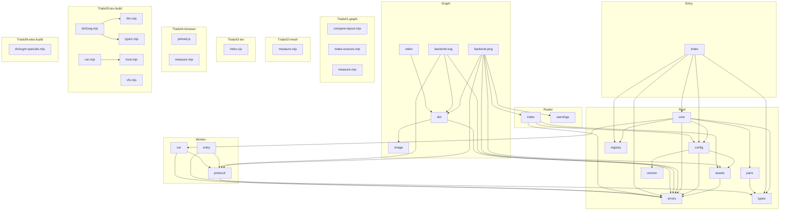

<!-- repo-map:no-verification -->
<!-- GENERATED FILE -- do not edit by hand.
     Regenerate with `repo-tools map`. -->

# @danielsimonjr/sciengjs - Dependency Graph

**Version**: 0.1.1

This document provides a comprehensive dependency graph of all files, components, imports, functions, and variables in the codebase.

---

## Table of Contents

1. [Overview](#overview)
2. [Package Dependencies](#package-dependencies)
3. [Root Dependencies](#root-dependencies)
4. [Graph Dependencies](#graph-dependencies)
5. [Entry Dependencies](#entry-dependencies)
6. [Raster Dependencies](#raster-dependencies)
7. [Worker Dependencies](#worker-dependencies)
8. [Trials/t1 graph Dependencies](#trials-t1-graph-dependencies)
9. [Trials/t2 mesh Dependencies](#trials-t2-mesh-dependencies)
10. [Trials/t3 tex Dependencies](#trials-t3-tex-dependencies)
11. [Trials/t4 browser Dependencies](#trials-t4-browser-dependencies)
12. [Trials/t5 tex build Dependencies](#trials-t5-tex-build-dependencies)
13. [Trials/t6 etex build Dependencies](#trials-t6-etex-build-dependencies)
14. [Dependency Matrix](#dependency-matrix)
15. [Circular Dependency Analysis](#circular-dependency-analysis)
16. [Visual Dependency Graph](#visual-dependency-graph)
17. [Summary Statistics](#summary-statistics)

---

<a id="overview"></a>
## Overview

The codebase is organized into the following modules:

- **root**: 8 files
- **graph**: 5 files
- **entry**: 1 file
- **raster**: 2 files
- **worker**: 3 files
- **trials/t1-graph**: 3 files
- **trials/t2-mesh**: 1 file
- **trials/t3-tex**: 1 file
- **trials/t4-browser**: 2 files
- **trials/t5-tex-build**: 6 files
- **trials/t6-etex-build**: 1 file

---

<a id="root-dependencies"></a>

## Root Dependencies

### `src/assets.ts` - assets module

**Node.js Built-in Dependencies:**
| Module | Import |
|--------|--------|
| `fs` | `readFileSync` |
| `url` | `fileURLToPath` |

**Internal Dependencies:**
| File | Imports | Type |
|------|---------|------|
| `./errors.ts` | `RenderError` | Import |

**Exports:**
- Functions: `checkAssetsUrl`, `assetFile`, `bundledFontPathIn`, `readAsset`
- Constants: `BUNDLED_FONT_FILE`, `RESVG_WASM_FILE`

---

### `src/config.ts` - Resolves the configuration. Precedence: call option, then environment, then file, then default.

**Node.js Built-in Dependencies:**
| Module | Import |
|--------|--------|
| `os` | `homedir` |
| `fs/promises` | `readFile` |
| `path` | `default` |

**Internal Dependencies:**
| File | Imports | Type |
|------|---------|------|
| `./errors.ts` | `RenderError` | Import |
| `./version.ts` | `ENGINE_VERSION` | Import |
| `./assets.ts` | `checkAssetsUrl` | Import |

**Exports:**
- Interfaces: `SciengConfig`, `ConfigDeps`
- Types: `NetworkPolicy`
- Functions: `loadConfig`
- Constants: `DEFAULT_ASSETS_URL`

---

### `src/core.ts` - Renders one request. The registry and the config dependencies are parameters so that tests

**Internal Dependencies:**
| File | Imports | Type |
|------|---------|------|
| `./config.ts` | `loadConfig, ConfigDeps, SciengConfig` | Import |
| `./errors.ts` | `RenderError` | Import |
| `./pairs.ts` | `PAIRS, findPair` | Import |
| `./registry.ts` | `registryKey, Registry` | Import |
| `./worker/run.ts` | `runInWorker` | Import |
| `./types.ts` | `BINARY_INPUT_TYPES, INPUT_TYPES, OUTPUT_FORMATS, Capability, OutputFormat, RenderOptions, RenderRequest, RenderResult` | Import |

**Exports:**
- Functions: `renderWithRegistry`, `capabilitiesWithRegistry`

---

### `src/errors.ts` - Whether the value is a render error, decided structurally instead of by class identity.

**Exports:**
- Classes: `RenderError`
- Interfaces: `RenderErrorPosition`
- Types: `RenderErrorCode`
- Functions: `isRenderError`
- Constants: `RENDER_ERROR_CODES`

---

### `src/pairs.ts` - pairs module

**Internal Dependencies:**
| File | Imports | Type |
|------|---------|------|
| `./types.ts` | `InputType, OutputFormat` | Import (type-only) |

**Exports:**
- Interfaces: `PairSpec`
- Functions: `findPair`
- Constants: `PAIRS`

---

### `src/registry.ts` - registry module

**Node.js Built-in Dependencies:**
| Module | Import |
|--------|--------|
| `path` | `extname` |
| `url` | `fileURLToPath` |

**Exports:**
- Interfaces: `BackendEntry`
- Types: `Registry`
- Functions: `registryKey`
- Constants: `DEFAULT_REGISTRY`

---

### `src/types.ts` - types module

**Exports:**
- Interfaces: `RenderRequest`, `RenderAsset`, `RenderResult`, `Capability`
- Types: `InputType`, `OutputFormat`, `RenderOptions`
- Constants: `INPUT_TYPES`, `OUTPUT_FORMATS`, `BINARY_INPUT_TYPES`

---

### `src/version.ts` - Generated by scripts/prepare-build.mjs from package.json. Do not edit this file by hand.

**Exports:**
- Constants: `ENGINE_VERSION`

---

<a id="graph-dependencies"></a>

## Graph Dependencies

### `src/graph/backend-png.ts` - backend-png module

**Node.js Built-in Dependencies:**
| Module | Import |
|--------|--------|
| `fs` | `readFileSync` |

**Internal Dependencies:**
| File | Imports | Type |
|------|---------|------|
| `../errors.ts` | `RenderError` | Import |
| `../assets.ts` | `bundledFontPathIn` | Import |
| `../worker/protocol.ts` | `BackendOutput, WorkerJob` | Import (type-only) |
| `./dot.ts` | `dotSourceText, dotToSvg` | Import |
| `../raster/index.ts` | `isFontFile, svgToPng` | Import |
| `../raster/warnings.ts` | `rasterWarnings` | Import |

**Exports:**
- Functions: `render`, `renderPng`

---

### `src/graph/backend-svg.ts` - backend-svg module

**Internal Dependencies:**
| File | Imports | Type |
|------|---------|------|
| `../errors.ts` | `RenderError` | Import |
| `../worker/protocol.ts` | `BackendOutput, WorkerJob` | Import (type-only) |
| `./dot.ts` | `dotSourceText, dotToSvg` | Import |

**Exports:**
- Functions: `render`

---

### `src/graph/dot.ts` - dot module

**Internal Dependencies:**
| File | Imports | Type |
|------|---------|------|
| `../errors.ts` | `RenderError` | Import |
| `./image.ts` | `stripImageAttributes, dropImageElements, dropStylesheetInstructions` | Import |

**Exports:**
- Interfaces: `DotSvgResult`
- Functions: `dotToSvg`, `dotSourceText`

---

### `src/graph/image.ts` - DOT identifiers take every byte from 0x80 upward, so every non-ASCII character counts as a letter.

**Exports:**
- Interfaces: `ImageRemoval`, `StripResult`
- Functions: `stripImageAttributes`, `dropImageElements`, `dropStylesheetInstructions`

---

### `src/graph/index.ts` - Package entry point for graph (re-exports 2 symbols)

**Internal Dependencies:**
| File | Imports | Type |
|------|---------|------|
| `./dot.ts` | `dotToSvg` | Re-export |
| `./dot.ts` | `DotSvgResult` | Re-export (type-only) |

**Exports:**
- Re-exports: `dotToSvg`, `DotSvgResult`

---

<a id="entry-dependencies"></a>

## Entry Dependencies

### `src/index.ts` - Package entry point for src (re-exports 15 symbols)

**Internal Dependencies:**
| File | Imports | Type |
|------|---------|------|
| `./core.ts` | `capabilitiesWithRegistry, renderWithRegistry` | Import |
| `./registry.ts` | `DEFAULT_REGISTRY` | Import |
| `./config.ts` | `SciengConfig` | Import (type-only) |
| `./types.ts` | `Capability, RenderRequest, RenderResult` | Import (type-only) |
| `./errors.ts` | `RenderError, RENDER_ERROR_CODES, RenderErrorCode` | Re-export |
| `./config.ts` | `loadConfig, SciengConfig, NetworkPolicy` | Re-export |
| `./types.ts` | `INPUT_TYPES, OUTPUT_FORMATS, InputType, OutputFormat, RenderOptions, RenderRequest, RenderResult, RenderAsset, Capability` | Re-export |

**Exports:**
- Functions: `render`, `capabilities`
- Re-exports:

  ```text
  RenderError, RENDER_ERROR_CODES, RenderErrorCode, loadConfig, SciengConfig, NetworkPolicy,
  INPUT_TYPES, OUTPUT_FORMATS, InputType, OutputFormat, RenderOptions, RenderRequest, RenderResult,
  RenderAsset, Capability
  ```


---

<a id="raster-dependencies"></a>

## Raster Dependencies

### `src/raster/index.ts` - The most megabytes of RGBA pixels that one PNG render accepts. Measured: a render holds about two

**External Dependencies:**
| Package | Import |
|---------|--------|
| `@resvg/resvg-wasm` | `initWasm, Resvg` |

**Internal Dependencies:**
| File | Imports | Type |
|------|---------|------|
| `../assets.ts` | `readAsset, RESVG_WASM_FILE` | Import |
| `../config.ts` | `DEFAULT_ASSETS_URL` | Import |
| `../errors.ts` | `RenderError` | Import |

**Exports:**
- Interfaces: `SvgToPngOptions`
- Functions: `svgToPng`, `isFontFile`
- Constants: `MAX_PNG_PIXEL_MB`

---

### `src/raster/warnings.ts` - Reads the Unicode character map of a TrueType or OpenType font (formats 4 and 12).

**Exports:**
- Types: `CoverageTest`
- Functions: `fontCovers`, `rasterWarnings`

---

<a id="worker-dependencies"></a>

## Worker Dependencies

### `src/worker/entry.ts` - The worker side of a render. The worker loads the backend module, runs one request and posts one message.

**Node.js Built-in Dependencies:**
| Module | Import |
|--------|--------|
| `worker_threads` | `parentPort, workerData` |

**Internal Dependencies:**
| File | Imports | Type |
|------|---------|------|
| `../errors.ts` | `RenderError, RENDER_ERROR_CODES, isRenderError, RenderErrorCode` | Import |
| `./protocol.ts` | `BackendOutput, WorkerJob, WorkerMessage` | Import (type-only) |

---

### `src/worker/protocol.ts` - Type definitions (3 interfaces, 1 type aliases)

**Internal Dependencies:**
| File | Imports | Type |
|------|---------|------|
| `../types.ts` | `InputType, OutputFormat, RenderOptions` | Import (type-only) |

**Exports:**
- Interfaces: `BackendSettings`, `WorkerJob`, `BackendOutput`
- Types: `WorkerMessage`

---

### `src/worker/run.ts` - The heap limit of the worker, in megabytes. Node enforces it. Bun 1.4.4 accepts the option

**Node.js Built-in Dependencies:**
| Module | Import |
|--------|--------|
| `worker_threads` | `Worker` |
| `path` | `extname` |
| `url` | `fileURLToPath` |

**Internal Dependencies:**
| File | Imports | Type |
|------|---------|------|
| `../errors.ts` | `RenderError` | Import |
| `./protocol.ts` | `BackendOutput, WorkerJob, WorkerMessage` | Import (type-only) |

**Exports:**
- Interfaces: `WorkerExit`, `WorkerLimits`
- Functions: `runInWorker`

---

<a id="trials-t1-graph-dependencies"></a>

## Trials/t1 graph Dependencies

### `trials/t1-graph/compare-layout.mjs` - Trial T1: compare the node layout of two Graphviz SVG files of the same DOT source.

**Node.js Built-in Dependencies:**
| Module | Import |
|--------|--------|
| `fs` | `readFileSync` |

---

### `trials/t1-graph/make-sources.mjs` - Writes the generated DOT sources of trial T1. The measurement script and the

**Node.js Built-in Dependencies:**
| Module | Import |
|--------|--------|
| `fs` | `writeFileSync` |
| `path` | `dirname, join` |
| `url` | `fileURLToPath` |

---

### `trials/t1-graph/measure.mjs` - Trial T1: measure @viz-js/viz on Bun or Node. Runs unchanged under both.

**Node.js Built-in Dependencies:**
| Module | Import |
|--------|--------|
| `crypto` | `createHash` |
| `fs` | `existsSync, mkdirSync, readFileSync, readdirSync, statSync, writeFileSync` |
| `path` | `dirname, join` |
| `url` | `fileURLToPath` |

---

<a id="trials-t2-mesh-dependencies"></a>

## Trials/t2 mesh Dependencies

### `trials/t2-mesh/measure.mjs` - Trial T2: measure occt-import-js on Bun or Node. Runs unchanged under both.

**Node.js Built-in Dependencies:**
| Module | Import |
|--------|--------|
| `crypto` | `createHash` |
| `fs` | `readFileSync, readdirSync, statSync` |
| `path` | `dirname, join` |
| `url` | `fileURLToPath` |

---

<a id="trials-t3-tex-dependencies"></a>

## Trials/t3 tex Dependencies

### `trials/t3-tex/shim/index.cjs` - Stand-in for the node-kpathsea addon that web2js library.js requires.

---

<a id="trials-t4-browser-dependencies"></a>

## Trials/t4 browser Dependencies

### `trials/t4-browser/assets/pinned.js` - The local copy of the pinned asset. The client serves it for the pinned URL in config.json.

---

### `trials/t4-browser/measure.mjs` - A proxy that refuses every connection. It records each attempt (the first line of the request)

**Node.js Built-in Dependencies:**
| Module | Import |
|--------|--------|
| `child_process` | `spawn` |
| `net` | `createServer` |
| `fs` | `existsSync, mkdirSync, mkdtempSync, readFileSync, rmSync, writeFileSync, appendFileSync` |
| `os` | `arch, platform, release, tmpdir` |
| `path` | `dirname, join` |
| `url` | `fileURLToPath` |
| `zlib` | `inflateSync` |

---

<a id="trials-t5-tex-build-dependencies"></a>

## Trials/t5 tex build Dependencies

### `trials/t5-tex-build/runtime/dvi2svg.mjs` - a font with no PFB keeps its TFM advances, and each of its glyphs goes in the missing list

**Internal Dependencies:**
| File | Imports | Type |
|------|---------|------|
| `./tfm.mjs` | `readTfm` | Import |
| `./type1.mjs` | `readType1` | Import |

**Exports:**
- Functions: `dviToSvg`

---

### `trials/t5-tex-build/runtime/host.mjs` - Host functions of the T5 trial: the Pascal file model on a virtual file system.

**Exports:**
- Classes: `ExitSignal`, `Host`

---

### `trials/t5-tex-build/runtime/run.mjs` - Run one compiled Pascal program on the virtual file system.

**Internal Dependencies:**
| File | Imports | Type |
|------|---------|------|
| `./host.mjs` | `Host, ExitSignal` | Import |

**Exports:**
- Functions: `runProgram`

---

### `trials/t5-tex-build/runtime/tfm.mjs` - TFM reader of the trial: the character widths and the design size.

**Exports:**
- Functions: `readTfm`

---

### `trials/t5-tex-build/runtime/type1.mjs` - Type 1 font reader of the trial: PFB (or PFA) to SVG path data for each glyph.

**Exports:**
- Functions: `readType1`

---

### `trials/t5-tex-build/runtime/vfs.mjs` - A virtual file system for the TeX runs of the trial. Reads come from an

**Node.js Built-in Dependencies:**
| Module | Import |
|--------|--------|
| `fs` | `default` |
| `path` | `default` |

**Exports:**
- Classes: `TreeFS`
- Constants: `flatName`

---

<a id="trials-t6-etex-build-dependencies"></a>

## Trials/t6 etex build Dependencies

### `trials/t6-etex-build/runtime/dvisvgm-specials.mjs` - The SVG unit of the specials of dvisvgm: the big point (72 bp = 72.27 pt).

**Exports:**
- Functions: `createSpecials`
- Constants: `unitPerPt`

---

<a id="dependency-matrix"></a>
## Dependency Matrix

### File Import/Export Matrix

| File | Imports From | Exports To |
|------|--------------|------------|
| `src/errors` | 0 files | 10 files |
| `src/core` | 6 files | 1 file |
| `src/config` | 3 files | 3 files |
| `src/graph/backend-png` | 6 files | 0 files |
| `src/graph/dot` | 2 files | 3 files |
| `src/index` | 5 files | 0 files |
| `src/worker/protocol` | 1 file | 4 files |
| `src/assets` | 1 file | 3 files |
| `src/raster/index` | 3 files | 1 file |
| `src/types` | 0 files | 4 files |
| `src/graph/backend-svg` | 3 files | 0 files |
| `src/worker/run` | 2 files | 1 file |
| `src/pairs` | 1 file | 1 file |
| `src/registry` | 0 files | 2 files |
| `src/worker/entry` | 2 files | 0 files |
| `trials/t5-tex-build/runtime/dvi2svg.mjs` | 2 files | 0 files |
| `src/graph/image` | 0 files | 1 file |
| `src/graph/index` | 1 file | 0 files |
| `src/raster/warnings` | 0 files | 1 file |
| `src/version` | 0 files | 1 file |
| `trials/t5-tex-build/runtime/host.mjs` | 0 files | 1 file |
| `trials/t5-tex-build/runtime/run.mjs` | 1 file | 0 files |
| `trials/t5-tex-build/runtime/tfm.mjs` | 0 files | 1 file |
| `trials/t5-tex-build/runtime/type1.mjs` | 0 files | 1 file |
| `trials/t1-graph/compare-layout.mjs` | 0 files | 0 files |
| `trials/t1-graph/make-sources.mjs` | 0 files | 0 files |
| `trials/t1-graph/measure.mjs` | 0 files | 0 files |
| `trials/t2-mesh/measure.mjs` | 0 files | 0 files |
| `trials/t3-tex/shim/index.cjs` | 0 files | 0 files |
| `trials/t4-browser/assets/pinned.js` | 0 files | 0 files |
| `trials/t4-browser/measure.mjs` | 0 files | 0 files |
| `trials/t5-tex-build/runtime/vfs.mjs` | 0 files | 0 files |
| `trials/t6-etex-build/runtime/dvisvgm-specials.mjs` | 0 files | 0 files |

---

<a id="circular-dependency-analysis"></a>
## Circular Dependency Analysis

**No circular dependencies detected.**
---

<a id="visual-dependency-graph"></a>
## Visual Dependency Graph



---

<a id="summary-statistics"></a>
## Summary Statistics

| Category | Count |
|----------|-------|
| Total Source Files | 107 |
| Subsystems | 11 |
| Total Lines of Code | 11606 |
| Total Exports | 169 |
| Total Re-exports | 18 |
| Total Classes | 5 |
| Total Interfaces | 23 |
| Total Functions | 84 |
| Total Type Guards | 2 |
| Total Enums | 0 |
| Type-only Imports | 14 |
| Runtime Cyclic Components | 0 |
| Type-only Cyclic Components | 0 |
| Files in Runtime Cycles | 0 |
| Files in Type-only Cycles | 0 |

---

*Version*: 0.1.1
