<!-- repo-map:no-verification -->
<!-- GENERATED FILE -- do not edit by hand.
     Regenerate with `repo-tools map`. -->

# @danielsimonjr/sciengjs - Dependency Graph

**Version**: 1.0.6

This document provides a comprehensive dependency graph of all files, components, imports, functions, and variables in the codebase.

---

## Table of Contents

1. [Overview](#overview)
2. [Package Dependencies](#package-dependencies)
3. [Root Dependencies](#root-dependencies)
4. [Browser Dependencies](#browser-dependencies)
5. [Graph Dependencies](#graph-dependencies)
6. [Html Dependencies](#html-dependencies)
7. [Entry Dependencies](#entry-dependencies)
8. [Math Dependencies](#math-dependencies)
9. [Mermaid Dependencies](#mermaid-dependencies)
10. [Mesh Dependencies](#mesh-dependencies)
11. [Plot Dependencies](#plot-dependencies)
12. [Raster Dependencies](#raster-dependencies)
13. [Sysml Dependencies](#sysml-dependencies)
14. [Tex Dependencies](#tex-dependencies)
15. [Worker Dependencies](#worker-dependencies)
16. [Trials/t1 graph Dependencies](#trials-t1-graph-dependencies)
17. [Trials/t2 mesh Dependencies](#trials-t2-mesh-dependencies)
18. [Trials/t3 tex Dependencies](#trials-t3-tex-dependencies)
19. [Trials/t4 browser Dependencies](#trials-t4-browser-dependencies)
20. [Dependency Matrix](#dependency-matrix)
21. [Circular Dependency Analysis](#circular-dependency-analysis)
22. [Visual Dependency Graph](#visual-dependency-graph)
23. [Summary Statistics](#summary-statistics)

---

<a id="overview"></a>
## Overview

The codebase is organized into the following modules:

- **root**: 8 files
- **browser**: 11 files
- **graph**: 7 files
- **html**: 6 files
- **entry**: 1 file
- **math**: 6 files
- **mermaid**: 11 files
- **mesh**: 21 files
- **plot**: 8 files
- **raster**: 2 files
- **sysml**: 8 files
- **tex**: 16 files
- **worker**: 3 files
- **trials/t1-graph**: 3 files
- **trials/t2-mesh**: 1 file
- **trials/t3-tex**: 1 file
- **trials/t4-browser**: 2 files

---

<a id="root-dependencies"></a>

## Root Dependencies

### `src/assets.ts` - assets module

**Node.js Built-in Dependencies:**
| Module | Import |
|--------|--------|
| `fs` | `readFileSync` |
| `url` | `fileURLToPath` |

**Internal Dependencies:**
| File | Imports | Type |
|------|---------|------|
| `./errors.ts` | `RenderError` | Import |

**Exports:**
- Functions: `checkAssetsUrl`, `assetFile`, `bundledFontPathIn`, `readAsset`
- Constants: `BUNDLED_FONT_FILE`, `RESVG_WASM_FILE`

---

### `src/config.ts` - Resolves the configuration. Precedence: call option, then environment, then file, then default.

**Node.js Built-in Dependencies:**
| Module | Import |
|--------|--------|
| `os` | `homedir` |
| `fs/promises` | `readFile` |
| `path` | `default` |

**Internal Dependencies:**
| File | Imports | Type |
|------|---------|------|
| `./errors.ts` | `RenderError` | Import |
| `./version.ts` | `ENGINE_VERSION` | Import |
| `./assets.ts` | `checkAssetsUrl` | Import |

**Exports:**
- Interfaces: `SciengConfig`, `ConfigDeps`
- Types: `NetworkPolicy`
- Functions: `loadConfig`
- Constants: `DEFAULT_ASSETS_URL`

---

### `src/core.ts` - Renders one request. The registry and the config dependencies are parameters so that tests

**Internal Dependencies:**
| File | Imports | Type |
|------|---------|------|
| `./config.ts` | `loadConfig, ConfigDeps, SciengConfig` | Import |
| `./errors.ts` | `RenderError` | Import |
| `./pairs.ts` | `PAIRS, findPair` | Import |
| `./registry.ts` | `registryKey, Registry` | Import |
| `./worker/run.ts` | `runInWorker` | Import |
| `./worker/protocol.ts` | `BackendSettings` | Import (type-only) |
| `./types.ts` | `BINARY_INPUT_TYPES, INPUT_TYPES, OUTPUT_FORMATS, Capability, OutputFormat, RenderOptions, RenderRequest, RenderResult` | Import |

**Exports:**
- Functions: `renderWithRegistry`, `capabilitiesWithRegistry`

---

### `src/errors.ts` - Whether the value is a render error, decided structurally instead of by class identity.

**Exports:**
- Classes: `RenderError`
- Interfaces: `RenderErrorPosition`
- Types: `RenderErrorCode`
- Functions: `isRenderError`, `inputError`
- Constants: `RENDER_ERROR_CODES`

---

### `src/pairs.ts` - pairs module

**Internal Dependencies:**
| File | Imports | Type |
|------|---------|------|
| `./types.ts` | `InputType, OutputFormat` | Import (type-only) |

**Exports:**
- Interfaces: `PairSpec`
- Functions: `findPair`
- Constants: `PAIRS`

---

### `src/registry.ts` - Loads data in the parent process before the worker starts. The worker gets the result as `settings.texCore`.

**Node.js Built-in Dependencies:**
| Module | Import |
|--------|--------|
| `path` | `extname` |
| `url` | `fileURLToPath` |

**Internal Dependencies:**
| File | Imports | Type |
|------|---------|------|
| `./tex/bundles.ts` | `texCoreFiles, BundleSettings` | Import |
| `./tex/detect.ts` | `detectBundles` | Import |

**Exports:**
- Interfaces: `BackendEntry`
- Types: `Registry`
- Functions: `registryKey`
- Constants: `DEFAULT_REGISTRY`

---

### `src/types.ts` - types module

**Exports:**
- Interfaces: `RenderRequest`, `RenderAsset`, `RenderResult`, `Capability`
- Types: `InputType`, `OutputFormat`, `RenderOptions`
- Constants: `INPUT_TYPES`, `OUTPUT_FORMATS`, `BINARY_INPUT_TYPES`

---

### `src/version.ts` - Generated by scripts/prepare-build.mjs from package.json. Do not edit this file by hand.

**Exports:**
- Constants: `ENGINE_VERSION`

---

<a id="browser-dependencies"></a>

## Browser Dependencies

### `src/browser/backend-pdf.ts` - backend-pdf module

**Internal Dependencies:**
| File | Imports | Type |
|------|---------|------|
| `../worker/protocol.ts` | `BackendOutput, WorkerJob` | Import (type-only) |
| `./input.ts` | `blockedWarnings, browserPathOf, htmlSource, parsePdfOptions` | Import |
| `./render.ts` | `renderHtmlPage` | Import |

**Exports:**
- Functions: `render`

---

### `src/browser/backend-png.ts` - backend-png module

**Internal Dependencies:**
| File | Imports | Type |
|------|---------|------|
| `../worker/protocol.ts` | `BackendOutput, WorkerJob` | Import (type-only) |
| `./input.ts` | `blockedWarnings, browserPathOf, htmlSource, parsePngOptions` | Import |
| `./render.ts` | `renderHtmlPage` | Import |

**Exports:**
- Functions: `render`

---

### `src/browser/cdp.ts` - Sends one request. A request with no reply before its deadline rejects with E_TIMEOUT, and its pending entry

**Internal Dependencies:**
| File | Imports | Type |
|------|---------|------|
| `../errors.ts` | `RenderError` | Import |

**Exports:**
- Classes: `CdpConnection`
- Interfaces: `CdpSocket`
- Functions: `connectCdp`

---

### `src/browser/flags.ts` - The flags of every browser start. Each flag closes one route off the host. The client never adds

**Exports:**
- Interfaces: `FlagInputs`
- Functions: `forcedBrowserFlags`

---

### `src/browser/index.ts` - Package entry point for browser (re-exports 10 symbols)

**Internal Dependencies:**
| File | Imports | Type |
|------|---------|------|
| `./cdp.ts` | `CdpConnection, CdpSocket` | Re-export |
| `./flags.ts` | `forcedBrowserFlags, FlagInputs` | Re-export |
| `./proxy.ts` | `startRefusingProxy, RefusingProxy` | Re-export |
| `./render.ts` | `renderHtmlPage, HtmlPageRequest, HtmlPageResult, HtmlFormat` | Re-export |

**Exports:**
- Re-exports:

  ```text
  CdpConnection, CdpSocket, forcedBrowserFlags, FlagInputs, startRefusingProxy, RefusingProxy,
  renderHtmlPage, HtmlPageRequest, HtmlPageResult, HtmlFormat
  ```


---

### `src/browser/input.ts` - Checks the options of html to png. An unknown key, a bad value, a side over MAX_SIDE, a scale over MAX_SCALE

**Internal Dependencies:**
| File | Imports | Type |
|------|---------|------|
| `../errors.ts` | `RenderError` | Import |

**Exports:**
- Interfaces: `PngOptions`
- Functions: `parsePngOptions`, `parsePdfOptions`, `htmlSource`, `browserPathOf`, `blockedWarnings`
- Constants: `DEFAULT_WIDTH`, `DEFAULT_HEIGHT`, `DEFAULT_SCALE`, `MAX_SIDE`, `MAX_SCALE`, `MAX_DEVICE_PIXELS`, `MAX_BLOCKED_WARNINGS`, `MAX_WARNING_URL_CHARS`

---

### `src/browser/page.ts` - A page that loads the pinned Plotly build with its Subresource Integrity value and draws one figure.

**Exports:**
- Functions: `scriptJson`, `scriptData`, `plotlyPageHtml`, `svgPageHtml`, `mermaidPageHtml`

---

### `src/browser/pinned.ts` - The modules that the viewer page loads. The GLTFLoader imports the two utility modules by relative path, and

**Exports:**
- Interfaces: `PinnedAsset`, `ThreeModule`
- Constants:

  ```text
  MERMAID_VERSION, MERMAID_SHA256, MERMAID_FILE, MERMAID_CDN_URL, PINNED_ASSETS, PLOTLY_VERSION,
  PLOTLY_SHA256, PLOTLY_SRI, PLOTLY_CDN_URL, THREE_VERSION, THREE_CDN_BASE, THREE_MODULES,
  THREE_MAIN_URL
  ```


---

### `src/browser/profile.ts` - Removes the profile. A held file is retried until the deadline, a Date.now() time. Any other error, or a deadline with t

**Node.js Built-in Dependencies:**
| Module | Import |
|--------|--------|
| `fs` | `mkdtempSync, rmSync` |
| `os` | `tmpdir` |
| `path` | `join` |

**Internal Dependencies:**
| File | Imports | Type |
|------|---------|------|
| `../errors.ts` | `RenderError` | Import |

**Exports:**
- Functions: `makeProfile`, `removeProfile`
- Constants: `PROFILE_PREFIX`

---

### `src/browser/proxy.ts` - The host of an absolute URL, or of the authority of a CONNECT request ("host:port"). A value that is

**Node.js Built-in Dependencies:**
| Module | Import |
|--------|--------|
| `net` | `Server, Socket` |
| `events` | `once` |
| `http` | `IncomingMessage, ServerResponse` |
| `http` | `createServer` |

**Exports:**
- Interfaces: `RefusingProxy`
- Functions: `startRefusingProxy`

---

### `src/browser/render.ts` - The share of the render time that the page work may use. The rest is the budget for stopping the browser

**Node.js Built-in Dependencies:**
| Module | Import |
|--------|--------|
| `child_process` | `spawn, spawnSync, ChildProcess` |
| `fs` | `readFileSync, existsSync` |
| `path` | `join` |

**Internal Dependencies:**
| File | Imports | Type |
|------|---------|------|
| `../errors.ts` | `RenderError` | Import |
| `./cdp.ts` | `CdpConnection, connectCdp` | Import |
| `./flags.ts` | `forcedBrowserFlags` | Import |
| `./input.ts` | `MAX_DEVICE_PIXELS` | Import |
| `./profile.ts` | `makeProfile, removeProfile` | Import |
| `./proxy.ts` | `startRefusingProxy, RefusingProxy` | Import |

**Exports:**
- Interfaces: `PinnedBytes`, `HtmlPageResult`
- Types: `HtmlFormat`, `HtmlPageRequest`
- Functions: `capturePage`, `killTree`, `renderHtmlPage`
- Constants: `PAGE_URL`

---

<a id="graph-dependencies"></a>

## Graph Dependencies

### `src/graph/backend-pdf.ts` - backend-pdf module

**Internal Dependencies:**
| File | Imports | Type |
|------|---------|------|
| `../errors.ts` | `RenderError` | Import |
| `../worker/protocol.ts` | `BackendOutput, WorkerJob` | Import (type-only) |
| `../mermaid/browser.ts` | `drawSvgToPdf` | Import |
| `./dot.ts` | `dotToSvg` | Import |
| `./text.ts` | `sourceText` | Import |

**Exports:**
- Functions: `render`

---

### `src/graph/backend-png.ts` - Rasterizes one SVG document to PNG at the given scale. The font follows render: the rasterFont setting when set,

**Node.js Built-in Dependencies:**
| Module | Import |
|--------|--------|
| `fs` | `readFileSync` |

**Internal Dependencies:**
| File | Imports | Type |
|------|---------|------|
| `../errors.ts` | `RenderError` | Import |
| `../assets.ts` | `bundledFontPathIn` | Import |
| `../worker/protocol.ts` | `BackendOutput, WorkerJob` | Import (type-only) |
| `./dot.ts` | `dotToSvg` | Import |
| `./text.ts` | `sourceText` | Import |
| `../raster/index.ts` | `isFontFile, svgToPng` | Import |
| `../raster/warnings.ts` | `rasterWarnings` | Import |

**Exports:**
- Functions: `readScale`, `render`, `renderPng`, `svgDocumentToPng`

---

### `src/graph/backend-svg.ts` - backend-svg module

**Internal Dependencies:**
| File | Imports | Type |
|------|---------|------|
| `../errors.ts` | `RenderError` | Import |
| `../worker/protocol.ts` | `BackendOutput, WorkerJob` | Import (type-only) |
| `./dot.ts` | `dotToSvg` | Import |
| `./text.ts` | `sourceText` | Import |

**Exports:**
- Functions: `render`

---

### `src/graph/dot.ts` - dot module

**Internal Dependencies:**
| File | Imports | Type |
|------|---------|------|
| `../errors.ts` | `RenderError` | Import |
| `./image.ts` | `stripImageAttributes, dropImageElements, dropStylesheetInstructions` | Import |

**Exports:**
- Interfaces: `DotSvgResult`
- Functions: `dotToSvg`

---

### `src/graph/image.ts` - DOT identifiers take every byte from 0x80 upward, so every non-ASCII character counts as a letter.

**Exports:**
- Interfaces: `ImageRemoval`, `StripResult`
- Functions: `stripImageAttributes`, `dropImageElements`, `dropStylesheetInstructions`

---

### `src/graph/index.ts` - Package entry point for graph (re-exports 2 symbols)

**Internal Dependencies:**
| File | Imports | Type |
|------|---------|------|
| `./dot.ts` | `dotToSvg` | Re-export |
| `./dot.ts` | `DotSvgResult` | Re-export (type-only) |

**Exports:**
- Re-exports: `dotToSvg`, `DotSvgResult`

---

### `src/graph/text.ts` - Replaces each code point that XML 1.0 forbids with U+FFFD.

**Exports:**
- Functions: `sourceText`, `xmlSafe`, `escapeDot`, `escapeRecord`

---

<a id="html-dependencies"></a>

## Html Dependencies

### `src/html/backend-md.ts` - backend-md module

**Node.js Built-in Dependencies:**
| Module | Import |
|--------|--------|
| `dns/promises` | `lookup` |

**Internal Dependencies:**
| File | Imports | Type |
|------|---------|------|
| `../worker/protocol.ts` | `BackendOutput, WorkerJob` | Import (type-only) |
| `../errors.ts` | `RenderError` | Import |
| `../browser/input.ts` | `browserPathOf, blockedWarnings` | Import |
| `../browser/render.ts` | `renderHtmlPage` | Import |
| `./md.ts` | `convertPage` | Import |
| `./fetch-image.ts` | `createImageFetcher` | Import |

**Exports:**
- Functions: `render`

---

### `src/html/convert.ts` - Escapes the block marker at the start of each line of a run of inline Markdown.

**External Dependencies:**
| Package | Import |
|---------|--------|
| `parse5` | `parse, serializeOuter, DefaultTreeAdapterMap` |

**Exports:**
- Interfaces: `Asset`, `ConvertOptions`, `AssetCounter`, `ConvertResult`
- Functions: `isDropped`, `convertHtml`, `htmlToMarkdown`

---

### `src/html/fetch-image.ts` - True when the address is loopback, private, link-local or unspecified:

**Node.js Built-in Dependencies:**
| Module | Import |
|--------|--------|
| `http` | `request, IncomingMessage` |
| `https` | `request` |
| `net` | `isIP, LookupFunction` |

**Internal Dependencies:**
| File | Imports | Type |
|------|---------|------|
| `./images.ts` | `FetchedImage, FetchImage` | Import (type-only) |

**Exports:**
- Interfaces: `ImageFetcherOptions`
- Types: `LookupAll`
- Functions: `isPrivateAddress`, `createImageFetcher`

---

### `src/html/images.ts` - images module

**Exports:**
- Interfaces: `FetchedImage`
- Types: `FetchImage`
- Functions: `decodeDataUrl`, `extensionForMime`

---

### `src/html/index.ts` - Package entry point for html (re-exports 1 symbols)

**Internal Dependencies:**
| File | Imports | Type |
|------|---------|------|
| `./convert.ts` | `htmlToMarkdown` | Re-export |

**Exports:**
- Re-exports: `htmlToMarkdown`

---

### `src/html/md.ts` - Converts one page to Markdown. An image that is a data: URL becomes an asset without a network call. A remote

**External Dependencies:**
| Package | Import |
|---------|--------|
| `parse5` | `parse, serialize, DefaultTreeAdapterMap` |

**Internal Dependencies:**
| File | Imports | Type |
|------|---------|------|
| `./convert.ts` | `convertHtml, isDropped, AssetCounter` | Import |
| `./images.ts` | `decodeDataUrl, extensionForMime, FetchImage` | Import |
| `../config.ts` | `NetworkPolicy` | Import (type-only) |
| `../types.ts` | `RenderAsset` | Import (type-only) |

**Exports:**
- Interfaces: `PageOptions`, `PageResult`
- Functions: `convertPage`

---

<a id="entry-dependencies"></a>

## Entry Dependencies

### `src/index.ts` - Package entry point for src (re-exports 16 symbols)

**Internal Dependencies:**
| File | Imports | Type |
|------|---------|------|
| `./core.ts` | `capabilitiesWithRegistry, renderWithRegistry` | Import |
| `./registry.ts` | `DEFAULT_REGISTRY` | Import |
| `./config.ts` | `SciengConfig` | Import (type-only) |
| `./types.ts` | `Capability, RenderRequest, RenderResult` | Import (type-only) |
| `./errors.ts` | `RenderError, RENDER_ERROR_CODES, RenderErrorCode` | Re-export |
| `./config.ts` | `loadConfig, SciengConfig, NetworkPolicy` | Re-export |
| `./types.ts` | `INPUT_TYPES, BINARY_INPUT_TYPES, OUTPUT_FORMATS, InputType, OutputFormat, RenderOptions, RenderRequest, RenderResult, RenderAsset, Capability` | Re-export |

**Exports:**
- Functions: `render`, `capabilities`
- Re-exports:

  ```text
  RenderError, RENDER_ERROR_CODES, RenderErrorCode, loadConfig, SciengConfig, NetworkPolicy,
  INPUT_TYPES, BINARY_INPUT_TYPES, OUTPUT_FORMATS, InputType, OutputFormat, RenderOptions,
  RenderRequest, RenderResult, RenderAsset, Capability
  ```


---

<a id="math-dependencies"></a>

## Math Dependencies

### `src/math/backend-pdf.ts` - backend-pdf module

**Internal Dependencies:**
| File | Imports | Type |
|------|---------|------|
| `../errors.ts` | `RenderError` | Import |
| `../mermaid/browser.ts` | `drawSvgToPdf` | Import |
| `../worker/protocol.ts` | `BackendOutput, WorkerJob` | Import (type-only) |
| `./tex.ts` | `mathToSvg` | Import |

**Exports:**
- Functions: `render`

---

### `src/math/backend-png.ts` - backend-png module

**Internal Dependencies:**
| File | Imports | Type |
|------|---------|------|
| `../errors.ts` | `RenderError` | Import |
| `../graph/backend-png.ts` | `readScale, svgDocumentToPng` | Import |
| `../worker/protocol.ts` | `BackendOutput, WorkerJob` | Import (type-only) |
| `./tex.ts` | `mathToSvg` | Import |

**Exports:**
- Functions: `render`

---

### `src/math/backend-svg.ts` - backend-svg module

**Internal Dependencies:**
| File | Imports | Type |
|------|---------|------|
| `../errors.ts` | `RenderError` | Import |
| `../worker/protocol.ts` | `BackendOutput, WorkerJob` | Import (type-only) |
| `./tex.ts` | `mathToSvg` | Import |

**Exports:**
- Functions: `render`

---

### `src/math/font-ranges.ts` - Static imports of every dynamic font range of MathJax-Newcm, the default math font. Each import

**External Dependencies:**
| Package | Import |
|---------|--------|
| `@mathjax/mathjax-newcm-font/js/svg/dynamic/PUA.js` | `` |
| `@mathjax/mathjax-newcm-font/js/svg/dynamic/accents-b-i.js` | `` |
| `@mathjax/mathjax-newcm-font/js/svg/dynamic/accents.js` | `` |
| `@mathjax/mathjax-newcm-font/js/svg/dynamic/arabic.js` | `` |
| `@mathjax/mathjax-newcm-font/js/svg/dynamic/arrows.js` | `` |
| `@mathjax/mathjax-newcm-font/js/svg/dynamic/braille-d.js` | `` |
| `@mathjax/mathjax-newcm-font/js/svg/dynamic/braille.js` | `` |
| `@mathjax/mathjax-newcm-font/js/svg/dynamic/calligraphic.js` | `` |
| `@mathjax/mathjax-newcm-font/js/svg/dynamic/cherokee.js` | `` |
| `@mathjax/mathjax-newcm-font/js/svg/dynamic/cyrillic-ss.js` | `` |
| `@mathjax/mathjax-newcm-font/js/svg/dynamic/cyrillic.js` | `` |
| `@mathjax/mathjax-newcm-font/js/svg/dynamic/devanagari.js` | `` |
| `@mathjax/mathjax-newcm-font/js/svg/dynamic/double-struck.js` | `` |
| `@mathjax/mathjax-newcm-font/js/svg/dynamic/fraktur.js` | `` |
| `@mathjax/mathjax-newcm-font/js/svg/dynamic/greek-ss.js` | `` |
| `@mathjax/mathjax-newcm-font/js/svg/dynamic/greek.js` | `` |
| `@mathjax/mathjax-newcm-font/js/svg/dynamic/hebrew.js` | `` |
| `@mathjax/mathjax-newcm-font/js/svg/dynamic/latin-b.js` | `` |
| `@mathjax/mathjax-newcm-font/js/svg/dynamic/latin-bi.js` | `` |
| `@mathjax/mathjax-newcm-font/js/svg/dynamic/latin-i.js` | `` |
| `@mathjax/mathjax-newcm-font/js/svg/dynamic/latin.js` | `` |
| `@mathjax/mathjax-newcm-font/js/svg/dynamic/marrows.js` | `` |
| `@mathjax/mathjax-newcm-font/js/svg/dynamic/math.js` | `` |
| `@mathjax/mathjax-newcm-font/js/svg/dynamic/monospace-ex.js` | `` |
| `@mathjax/mathjax-newcm-font/js/svg/dynamic/monospace-l.js` | `` |
| `@mathjax/mathjax-newcm-font/js/svg/dynamic/monospace.js` | `` |
| `@mathjax/mathjax-newcm-font/js/svg/dynamic/mshapes.js` | `` |
| `@mathjax/mathjax-newcm-font/js/svg/dynamic/phonetics-ss.js` | `` |
| `@mathjax/mathjax-newcm-font/js/svg/dynamic/phonetics.js` | `` |
| `@mathjax/mathjax-newcm-font/js/svg/dynamic/sans-serif-b.js` | `` |
| `@mathjax/mathjax-newcm-font/js/svg/dynamic/sans-serif-bi.js` | `` |
| `@mathjax/mathjax-newcm-font/js/svg/dynamic/sans-serif-ex.js` | `` |
| `@mathjax/mathjax-newcm-font/js/svg/dynamic/sans-serif-i.js` | `` |
| `@mathjax/mathjax-newcm-font/js/svg/dynamic/sans-serif-r.js` | `` |
| `@mathjax/mathjax-newcm-font/js/svg/dynamic/sans-serif.js` | `` |
| `@mathjax/mathjax-newcm-font/js/svg/dynamic/script.js` | `` |
| `@mathjax/mathjax-newcm-font/js/svg/dynamic/shapes.js` | `` |
| `@mathjax/mathjax-newcm-font/js/svg/dynamic/symbols-b-i.js` | `` |
| `@mathjax/mathjax-newcm-font/js/svg/dynamic/symbols.js` | `` |
| `@mathjax/mathjax-newcm-font/js/svg/dynamic/variants.js` | `` |

**Exports:**
- Functions: `loadFontRanges`, `defineMhchemVariant`
- Constants: `MHCHEM_ALIASES`

---

### `src/math/index.ts` - Package entry point for math (re-exports 2 symbols)

**Internal Dependencies:**
| File | Imports | Type |
|------|---------|------|
| `./tex.ts` | `mathToSvg` | Re-export |
| `./tex.ts` | `MathOptions` | Re-export (type-only) |

**Exports:**
- Re-exports: `mathToSvg`, `MathOptions`

---

### `src/math/tex.ts` - Removes each `\require{...}` command from the source and returns the rest. The build loads every

**External Dependencies:**
| Package | Import |
|---------|--------|
| `@mathjax/src/js/adaptors/liteAdaptor.js` | `liteAdaptor` |
| `@mathjax/src/js/handlers/html.js` | `RegisterHTMLHandler` |
| `@mathjax/src/js/mathjax.js` | `mathjax` |
| `@mathjax/src/js/input/tex.js` | `TeX` |
| `@mathjax/src/js/output/svg.js` | `SVG` |
| `@mathjax/src/js/input/tex/base/BaseConfiguration.js` | `` |
| `@mathjax/src/js/input/tex/ams/AmsConfiguration.js` | `` |
| `@mathjax/src/js/input/tex/boldsymbol/BoldsymbolConfiguration.js` | `` |
| `@mathjax/src/js/input/tex/color/ColorConfiguration.js` | `` |
| `@mathjax/src/js/input/tex/mhchem/MhchemConfiguration.js` | `` |

**Internal Dependencies:**
| File | Imports | Type |
|------|---------|------|
| `../errors.ts` | `RenderError` | Import |
| `./font-ranges.ts` | `defineMhchemVariant, loadFontRanges` | Import |

**Exports:**
- Interfaces: `MathOptions`
- Functions: `stripRequires`, `rejectFontFallback`, `exToPx`, `standaloneSvg`, `mathToSvg`
- Constants: `MATH_PACKAGES`

---

<a id="mermaid-dependencies"></a>

## Mermaid Dependencies

### `src/mermaid/backend-pdf.ts` - Renders one Mermaid source to pdf in the browser stage. A native diagram is laid out first, then its SVG is

**Internal Dependencies:**
| File | Imports | Type |
|------|---------|------|
| `../worker/protocol.ts` | `BackendOutput, WorkerJob` | Import (type-only) |
| `../graph/text.ts` | `sourceText` | Import |
| `./common.ts` | `readLenient, routesToBrowser` | Import |
| `./browser.ts` | `drawMermaidInBrowser, drawSvgToPdf, MERMAID_NATIVE_PDF_BACKEND` | Import |
| `./render.ts` | `renderMermaidSvg` | Import |

**Exports:**
- Functions: `render`

---

### `src/mermaid/backend-png.ts` - Renders one Mermaid source to PNG. A native diagram is drawn to SVG and then to PNG by the raster stage.

**Internal Dependencies:**
| File | Imports | Type |
|------|---------|------|
| `../browser/input.ts` | `MAX_SCALE` | Import |
| `../errors.ts` | `RenderError` | Import |
| `../graph/backend-png.ts` | `readScale, svgDocumentToPng` | Import |
| `../worker/protocol.ts` | `BackendOutput, WorkerJob` | Import (type-only) |
| `../graph/text.ts` | `sourceText` | Import |
| `./common.ts` | `readLenient, routesToBrowser` | Import |
| `./browser.ts` | `drawMermaidInBrowser` | Import |
| `./render.ts` | `renderMermaidSvg` | Import |

**Exports:**
- Functions: `render`

---

### `src/mermaid/backend-svg.ts` - Renders one Mermaid source to SVG. A native diagram goes through the native layouts. Any other Mermaid type goes

**Internal Dependencies:**
| File | Imports | Type |
|------|---------|------|
| `../worker/protocol.ts` | `BackendOutput, WorkerJob` | Import (type-only) |
| `../graph/text.ts` | `sourceText` | Import |
| `./common.ts` | `readLenient, routesToBrowser` | Import |
| `./browser.ts` | `drawMermaidInBrowser` | Import |
| `./render.ts` | `renderMermaidSvg` | Import |

**Exports:**
- Functions: `render`

---

### `src/mermaid/browser.ts` - Draws one Mermaid source of a browser type through the browser stage. The page names the pinned Mermaid URL.

**Node.js Built-in Dependencies:**
| Module | Import |
|--------|--------|
| `crypto` | `createHash` |

**Internal Dependencies:**
| File | Imports | Type |
|------|---------|------|
| `../browser/input.ts` | `blockedWarnings, browserPathOf` | Import |
| `../browser/pinned.ts` | `MERMAID_CDN_URL, MERMAID_FILE, MERMAID_SHA256` | Import |
| `../errors.ts` | `RenderError` | Import |
| `../browser/page.ts` | `mermaidPageHtml, svgPageHtml` | Import |
| `../browser/render.ts` | `renderHtmlPage, HtmlFormat, HtmlPageRequest, PinnedBytes` | Import |
| `../assets.ts` | `readAsset` | Import |

**Exports:**
- Interfaces: `BrowserSettings`, `BrowserDraw`
- Functions: `drawMermaidInBrowser`, `drawSvgToPdf`, `pinnedMermaid`
- Constants: `MERMAID_BROWSER_BACKEND`, `MERMAID_NATIVE_PDF_BACKEND`

---

### `src/mermaid/class.ts` - class module

**Internal Dependencies:**
| File | Imports | Type |
|------|---------|------|
| `../errors.ts` | `inputError` | Import |
| `../graph/text.ts` | `escapeDot, escapeRecord` | Import |
| `./common.ts` | `outside, ContentLine, Source` | Import |

**Exports:**
- Interfaces: `ClassArrow`, `ClassDef`, `ClassRelation`, `ClassModel`
- Types: `Marker`
- Functions: `parseClassDiagram`, `classToDot`

---

### `src/mermaid/common.ts` - Reads the option `lenient` and checks the other keys. A key outside `lenient` and `extra` rejects with E_INPUT.

**Internal Dependencies:**
| File | Imports | Type |
|------|---------|------|
| `../errors.ts` | `inputError, RenderError` | Import |
| `../graph/text.ts` | `xmlSafe` | Import |

**Exports:**
- Interfaces: `ContentLine`, `Context`, `Source`
- Types: `DiagramKind`
- Functions: `readLenient`, `outside`, `prepare`, `routesToBrowser`

---

### `src/mermaid/index.ts` - The public surface of the Mermaid native layouts. It holds the header and option reader, the parsers,

**Internal Dependencies:**
| File | Imports | Type |
|------|---------|------|
| `./common.ts` | `prepare, Source` | Re-export |
| `./class.ts` | `parseClassDiagram, classToDot, ClassModel, ClassDef, ClassRelation, ClassArrow, Marker` | Re-export |
| `./state.ts` | `parseStateDiagram, stateToDot, StateModel, StateDef, StateTransition` | Re-export |
| `./sequence.ts` | `parseSequenceDiagram, SequenceModel, SeqEvent, Participant, MessageEvent, NoteEvent, ActivateEvent, DeactivateEvent, Branch, BlockEvent` | Re-export |
| `./sequence-layout.ts` | `layoutSequence` | Re-export |
| `./render.ts` | `renderMermaidSvg, MermaidSvg` | Re-export |

**Exports:**
- Re-exports:

  ```text
  prepare, Source, parseClassDiagram, classToDot, ClassModel, ClassDef, ClassRelation, ClassArrow,
  Marker, parseStateDiagram, stateToDot, StateModel, StateDef, StateTransition, parseSequenceDiagram,
  SequenceModel, SeqEvent, Participant, MessageEvent, NoteEvent, ActivateEvent, DeactivateEvent,
  Branch, BlockEvent, layoutSequence, renderMermaidSvg, MermaidSvg
  ```


---

### `src/mermaid/render.ts` - Renders one Mermaid source to SVG. A class or state diagram goes through DOT and the graph stage.

**Internal Dependencies:**
| File | Imports | Type |
|------|---------|------|
| `../graph/dot.ts` | `dotToSvg` | Import |
| `./class.ts` | `classToDot, parseClassDiagram` | Import |
| `./common.ts` | `prepare` | Import |
| `./sequence.ts` | `parseSequenceDiagram` | Import |
| `./sequence-layout.ts` | `layoutSequence` | Import |
| `./state.ts` | `parseStateDiagram, stateToDot` | Import |

**Exports:**
- Interfaces: `MermaidSvg`
- Functions: `renderMermaidSvg`

---

### `src/mermaid/sequence-layout.ts` - Lays out one sequence model into one SVG document string.

**Internal Dependencies:**
| File | Imports | Type |
|------|---------|------|
| `../graph/text.ts` | `xmlSafe` | Import |
| `./sequence.ts` | `BlockEvent, Branch, MessageEvent, SeqEvent, SequenceModel` | Import (type-only) |

**Exports:**
- Functions: `layoutSequence`

---

### `src/mermaid/sequence.ts` - sequence module

**Internal Dependencies:**
| File | Imports | Type |
|------|---------|------|
| `../errors.ts` | `inputError` | Import |
| `./common.ts` | `outside, Source` | Import |

**Exports:**
- Interfaces: `Participant`, `MessageEvent`, `NoteEvent`, `ActivateEvent`, `DeactivateEvent`, `Branch`, `BlockEvent`, `SequenceModel`
- Types: `SeqEvent`
- Functions: `parseSequenceDiagram`

---

### `src/mermaid/state.ts` - state module

**Internal Dependencies:**
| File | Imports | Type |
|------|---------|------|
| `../errors.ts` | `inputError` | Import |
| `../graph/text.ts` | `xmlSafe` | Import |
| `./common.ts` | `outside, ContentLine, Source` | Import |

**Exports:**
- Interfaces: `StateDef`, `StateTransition`, `StateModel`
- Functions: `parseStateDiagram`, `stateToDot`

---

<a id="mesh-dependencies"></a>

## Mesh Dependencies

### `src/mesh/backend-3mf.ts` - Renders a CAD document to a 3MF Core package. The worker calls this function. The package keeps the colours and

**Internal Dependencies:**
| File | Imports | Type |
|------|---------|------|
| `../errors.ts` | `RenderError` | Import |
| `../worker/protocol.ts` | `BackendOutput, WorkerJob` | Import (type-only) |
| `./backend-glb.ts` | `readMeshes` | Import |
| `./threemf.ts` | `threemfByteLength, write3mf` | Import |

**Exports:**
- Functions: `render`

---

### `src/mesh/backend-dfm.ts` - Renders a CAD document to a Markdown report of the design for manufacture. The worker calls this function.

**Internal Dependencies:**
| File | Imports | Type |
|------|---------|------|
| `../errors.ts` | `RenderError` | Import |
| `../worker/protocol.ts` | `BackendOutput, WorkerJob` | Import (type-only) |
| `./backend-glb.ts` | `readCadRequest` | Import |
| `./cad-build.ts` | `measureCad` | Import |
| `./dfm.ts` | `DfmOptions` | Import (type-only) |
| `./dfm.ts` | `DFM_DEFAULTS, writeDfmReport` | Import |

**Exports:**
- Functions: `render`

---

### `src/mesh/backend-dxf.ts` - Renders a CAD document to a DXF drawing in the X-Y plane. The worker calls this function. With no option, the

**Internal Dependencies:**
| File | Imports | Type |
|------|---------|------|
| `../errors.ts` | `RenderError` | Import |
| `../worker/protocol.ts` | `BackendOutput, WorkerJob` | Import (type-only) |
| `./backend-glb.ts` | `readCadRequest` | Import |
| `./cad-build.ts` | `drawCad` | Import |
| `./dxf.ts` | `dxfByteLength, writeDxf` | Import |

**Exports:**
- Functions: `render`

---

### `src/mesh/backend-glb.ts` - The number of copies of the geometry that a glb render holds at its peak: the typed arrays of the

**Internal Dependencies:**
| File | Imports | Type |
|------|---------|------|
| `../errors.ts` | `RenderError` | Import |
| `../worker/protocol.ts` | `BackendOutput, WorkerJob` | Import (type-only) |
| `./glb.ts` | `writeGlb` | Import |
| `./cad-build.ts` | `buildCad` | Import |
| `./cad-document.ts` | `parseCadDocument, CadDocument` | Import |
| `./read.ts` | `readCad, CadFormat, CadMesh, LinearUnit` | Import |

**Exports:**
- Interfaces: `GlbDeps`
- Functions: `estimateGlbBytes`, `readMeshOptions`, `readCadRequest`, `readMeshes`, `render`
- Constants: `GLB_COPIES`

---

### `src/mesh/backend-html.ts` - Renders a STEP, IGES or BREP file to html: one page with a Three.js viewer that embeds the glb. The page names the

**Internal Dependencies:**
| File | Imports | Type |
|------|---------|------|
| `../worker/protocol.ts` | `BackendOutput, WorkerJob` | Import (type-only) |
| `./backend-glb.ts` | `render` | Import |
| `./viewer.ts` | `viewerPageHtml` | Import |

**Exports:**
- Functions: `render`

---

### `src/mesh/backend-png.ts` - Renders a STEP, IGES or BREP file to png: the viewer page in the headless browser. The client fulfils the pinned

**Internal Dependencies:**
| File | Imports | Type |
|------|---------|------|
| `../browser/input.ts` | `blockedWarnings, browserPathOf, parsePngOptions` | Import |
| `../browser/render.ts` | `renderHtmlPage` | Import |
| `../worker/protocol.ts` | `BackendOutput, WorkerJob` | Import (type-only) |
| `./backend-glb.ts` | `render` | Import |
| `./pinned-three.ts` | `pinnedThree` | Import |
| `./viewer.ts` | `viewerPageHtml` | Import |

**Exports:**
- Functions: `render`

---

### `src/mesh/backend-stl.ts` - Renders a CAD document to a binary STL file. The worker calls this function. STL holds no colour and no name,

**Internal Dependencies:**
| File | Imports | Type |
|------|---------|------|
| `../errors.ts` | `RenderError` | Import |
| `../worker/protocol.ts` | `BackendOutput, WorkerJob` | Import (type-only) |
| `./backend-glb.ts` | `readMeshes` | Import |
| `./stl.ts` | `stlByteLength, writeStl` | Import |

**Exports:**
- Functions: `render`

---

### `src/mesh/cad-build.ts` - Builds the solid of a checked document and returns one mesh with flat normals at sharp edges.

**Internal Dependencies:**
| File | Imports | Type |
|------|---------|------|
| `../errors.ts` | `RenderError` | Import |
| `./cad-document.ts` | `CadDocument, ProfileNode, Rgb, SolidNode` | Import (type-only) |
| `./cad-document.ts` | `DEFAULT_SEGMENTS` | Import |
| `./read.ts` | `CadFace, CadMesh` | Import (type-only) |

**Exports:**
- Interfaces: `CadBuildResult`, `CadDrawing`, `ThinSection`, `CadMeasures`
- Functions: `loadManifold`, `buildCad`, `drawCad`, `measureCad`
- Constants: `WALL_SECTIONS`

---

### `src/mesh/cad-builder.ts` - The builder API: functions that write the nodes of a CAD document. A program that uses the builder functions runs in the

**Internal Dependencies:**
| File | Imports | Type |
|------|---------|------|
| `./cad-document.ts` | `BooleanNode, CadDocument, CadStyle, CircleNode, CubeNode, CylinderNode, ExtrudeNode, MirrorNode, PolygonNode, PolyhedronNode, ProfileNode, RectangleNode, RevolveNode, RotateNode, ScaleNode, SolidNode, SphereNode, TranslateNode, Vec2, Vec3` | Import (type-only) |

**Exports:**
- Types: `CubeOptions`, `RoundOptions`, `ExtrudeOptions`
- Functions:

  ```text
  cube, cylinder, sphere, polyhedron, rectangle, circle, polygon, extrude, revolve, union, difference,
  intersection, translate, rotate, scale, mirror, cadDocument
  ```


---

### `src/mesh/cad-document.ts` - cad-document module

**Internal Dependencies:**
| File | Imports | Type |
|------|---------|------|
| `../errors.ts` | `RenderError` | Import |

**Exports:**
- Interfaces:

  ```text
  CadStyle, CubeNode, CylinderNode, SphereNode, PolyhedronNode, RectangleNode, CircleNode,
  PolygonNode, ExtrudeNode, RevolveNode, BooleanNode, TranslateNode, RotateNode, ScaleNode,
  MirrorNode, CadDocument, CadLimits, CheckedCadDocument
  ```

- Types: `Vec2`, `Vec3`, `Rgb`, `ProfileNode`, `SolidNode`, `CadNode`
- Functions: `sphereFacets`, `checkCadDocument`, `parseCadDocument`
- Constants: `DEFAULT_SEGMENTS`, `MIN_SEGMENTS`, `MAX_SEGMENTS`

---

### `src/mesh/dfm.ts` - The area of the faces that need support when the model is printed upwards along +Z. A face needs support when

**Internal Dependencies:**
| File | Imports | Type |
|------|---------|------|
| `./cad-build.ts` | `CadMeasures` | Import (type-only) |
| `./cad-build.ts` | `ThinSection` | Import (type-only) |
| `./cad-build.ts` | `WALL_SECTIONS` | Import |

**Exports:**
- Interfaces: `DfmOptions`
- Functions: `supportArea`, `writeDfmReport`
- Constants: `DFM_DEFAULTS`

---

### `src/mesh/dxf.ts` - The DXF writer of the mesh stage (design section "CAD"). The output is ASCII DXF of release R12 (AC1009): a

**Exports:**
- Functions: `dxfByteLength`, `writeDxf`

---

### `src/mesh/glb.ts` - Writes meshes as one glTF 2.0 binary file. Each mesh is one glTF mesh. Its triangles are grouped

**Internal Dependencies:**
| File | Imports | Type |
|------|---------|------|
| `../errors.ts` | `RenderError` | Import |
| `./read.ts` | `CadFace, CadMesh` | Import (type-only) |

**Exports:**
- Functions: `triangleGroups`, `writeGlb`
- Constants: `DEFAULT_COLOUR`

---

### `src/mesh/index.ts` - Package entry point for mesh (re-exports 29 symbols)

**Internal Dependencies:**
| File | Imports | Type |
|------|---------|------|
| `./read.ts` | `readCad` | Re-export |
| `./read.ts` | `CadFormat, CadFace, CadMesh, LinearUnit` | Re-export (type-only) |
| `./glb.ts` | `writeGlb` | Re-export |
| `./backend-glb.ts` | `readMeshOptions` | Re-export |
| `./stl.ts` | `writeStl` | Re-export |
| `./threemf.ts` | `write3mf` | Re-export |
| `./dxf.ts` | `writeDxf` | Re-export |
| `./dfm.ts` | `DFM_DEFAULTS, supportArea, writeDfmReport` | Re-export |
| `./dfm.ts` | `DfmOptions` | Re-export (type-only) |
| `./cad-document.ts` | `checkCadDocument, parseCadDocument, DEFAULT_SEGMENTS, MAX_SEGMENTS, MIN_SEGMENTS` | Re-export |
| `./cad-document.ts` | `*` | Re-export (type-only) |
| `./cad-build.ts` | `buildCad, drawCad, measureCad, WALL_SECTIONS` | Re-export |
| `./cad-build.ts` | `CadBuildResult, CadDrawing, CadMeasures, ThinSection` | Re-export (type-only) |
| `./cad-builder.ts` | `*` | Re-export |

**Exports:**
- Re-exports:

  ```text
  readCad, CadFormat, CadFace, CadMesh, LinearUnit, writeGlb, readMeshOptions, writeStl, write3mf,
  writeDxf, DFM_DEFAULTS, supportArea, writeDfmReport, DfmOptions, checkCadDocument, parseCadDocument,
  DEFAULT_SEGMENTS, MAX_SEGMENTS, MIN_SEGMENTS, type * from ./cad-document.ts, buildCad, drawCad,
  measureCad, WALL_SECTIONS, CadBuildResult, CadDrawing, CadMeasures, ThinSection, cad
  ```


---

### `src/mesh/occt-import-js.d.ts` - The package occt-import-js 0.0.23 ships no type declarations. This file declares its factory.

**Exports:**
- Default: `default`

---

### `src/mesh/pinned-three.ts` - Reads the pinned Three.js files from the assets folder and checks the SHA-256 of each. A missing file rejects with

**Node.js Built-in Dependencies:**
| Module | Import |
|--------|--------|
| `crypto` | `createHash` |

**Internal Dependencies:**
| File | Imports | Type |
|------|---------|------|
| `../browser/pinned.ts` | `THREE_MODULES` | Import |
| `../browser/render.ts` | `PinnedBytes` | Import (type-only) |
| `../assets.ts` | `readAsset` | Import |
| `../errors.ts` | `RenderError` | Import |

**Exports:**
- Functions: `pinnedThree`

---

### `src/mesh/read.ts` - Reads a STEP, IGES or BREP file to meshes. The linear unit applies to STEP and IGES only.

**Internal Dependencies:**
| File | Imports | Type |
|------|---------|------|
| `../errors.ts` | `RenderError` | Import |

**Exports:**
- Interfaces: `CadFace`, `CadMesh`
- Types: `CadFormat`, `LinearUnit`
- Functions: `readCad`

---

### `src/mesh/stl.ts` - Writes the meshes as one binary STL file, little-endian. Each facet normal comes from the vertices of the facet

**Internal Dependencies:**
| File | Imports | Type |
|------|---------|------|
| `./read.ts` | `CadMesh` | Import (type-only) |

**Exports:**
- Functions: `stlFacetCount`, `stlByteLength`, `writeStl`

---

### `src/mesh/threemf.ts` - The 3MF writer of the mesh stage (design section "CAD"). The output is a 3MF Core package: a ZIP archive with

**Internal Dependencies:**
| File | Imports | Type |
|------|---------|------|
| `../errors.ts` | `RenderError` | Import |
| `./glb.ts` | `DEFAULT_COLOUR, triangleGroups` | Import |
| `./read.ts` | `CadMesh` | Import (type-only) |

**Exports:**
- Functions: `threemfByteLength`, `write3mf`

---

### `src/mesh/viewer-script.ts` - The module script of the viewer page. The page builder replaces three markers before it writes the page:

**Exports:**
- Constants: `VIEWER_SCRIPT`

---

### `src/mesh/viewer.ts` - A page that views one glTF binary. The page embeds the glb as base64 text and loads the pinned Three.js modules

**Internal Dependencies:**
| File | Imports | Type |
|------|---------|------|
| `../browser/pinned.ts` | `THREE_MAIN_URL, THREE_MODULES` | Import |
| `./viewer-script.ts` | `VIEWER_SCRIPT` | Import |

**Exports:**
- Interfaces: `ViewerOptions`
- Functions: `viewerPageHtml`

---

<a id="plot-dependencies"></a>

## Plot Dependencies

### `src/plot/backend-html.ts` - backend-html module

**Internal Dependencies:**
| File | Imports | Type |
|------|---------|------|
| `../browser/page.ts` | `plotlyPageHtml` | Import |
| `../browser/pinned.ts` | `PLOTLY_CDN_URL, PLOTLY_SRI` | Import |
| `../worker/protocol.ts` | `BackendOutput, WorkerJob` | Import (type-only) |
| `./backend-svg.ts` | `readPlotOptions` | Import |
| `./reader.ts` | `readPlotFigure` | Import |

**Exports:**
- Functions: `render`

---

### `src/plot/backend-png.ts` - backend-png module

**Internal Dependencies:**
| File | Imports | Type |
|------|---------|------|
| `../graph/backend-png.ts` | `readScale, svgDocumentToPng` | Import |
| `../worker/protocol.ts` | `BackendOutput, WorkerJob` | Import (type-only) |
| `./plotter.ts` | `plotToSvg` | Import |
| `./backend-svg.ts` | `readPlotOptions` | Import |

**Exports:**
- Functions: `render`

---

### `src/plot/backend-svg.ts` - backend-svg module

**Internal Dependencies:**
| File | Imports | Type |
|------|---------|------|
| `../errors.ts` | `RenderError` | Import |
| `../worker/protocol.ts` | `BackendOutput, WorkerJob` | Import (type-only) |
| `./plotter.ts` | `plotToSvg` | Import |

**Exports:**
- Functions: `readPlotOptions`, `render`

---

### `src/plot/control.ts` - Key values of a step response: final value, rise and settling times, overshoot in percent, and peak time.

**Internal Dependencies:**
| File | Imports | Type |
|------|---------|------|
| `../errors.ts` | `RenderError` | Import |

**Exports:**
- Interfaces:

  ```text
  TransferFunction, Complex, ControlFigure, ControlResult, FrequencyOptions, TimeOptions,
  RootLocusOptions, BodeNumbers, StepNumbers, ImpulseNumbers, PoleZeroNumbers, NyquistNumbers,
  RootLocusNumbers
  ```

- Functions: `checkTransferFunction`, `polynomialRoots`, `bode`, `step`, `impulse`, `poleZero`, `nyquist`, `rootLocus`

---

### `src/plot/index.ts` - Package entry point for plot (re-exports 23 symbols)

**Internal Dependencies:**
| File | Imports | Type |
|------|---------|------|
| `./plotter.ts` | `plotToSvg` | Re-export |
| `./reader.ts` | `readPlotFigure` | Re-export |
| `./ticks.ts` | `linearTicks, logTicks, paddedRange` | Re-export |
| `./control.ts` | `bode, step, impulse, poleZero, nyquist, rootLocus, checkTransferFunction, polynomialRoots` | Re-export |
| `./control.ts` | `TransferFunction, Complex, ControlFigure, ControlResult, BodeNumbers, StepNumbers, ImpulseNumbers, PoleZeroNumbers, NyquistNumbers, RootLocusNumbers` | Re-export (type-only) |

**Exports:**
- Re-exports:

  ```text
  plotToSvg, readPlotFigure, linearTicks, logTicks, paddedRange, bode, step, impulse, poleZero,
  nyquist, rootLocus, checkTransferFunction, polynomialRoots, TransferFunction, Complex,
  ControlFigure, ControlResult, BodeNumbers, StepNumbers, ImpulseNumbers, PoleZeroNumbers,
  NyquistNumbers, RootLocusNumbers
  ```


---

### `src/plot/plotter.ts` - Plotly figure subset to standalone SVG. Every number is formatted with a fixed

**Internal Dependencies:**
| File | Imports | Type |
|------|---------|------|
| `../errors.ts` | `RenderError` | Import |
| `./reader.ts` | `readPlotFigure` | Import |
| `./ticks.ts` | `MAX_TICKS, linearTicks, logTicks, paddedRange` | Import |

**Exports:**
- Functions: `plotToSvg`

---

### `src/plot/reader.ts` - Table-driven reader for the Plotly JSON subset. Each allowed key is a dotted

**Internal Dependencies:**
| File | Imports | Type |
|------|---------|------|
| `../errors.ts` | `RenderError` | Import |

**Exports:**
- Functions: `readPlotFigure`

---

### `src/plot/ticks.ts` - ticks module

**Internal Dependencies:**
| File | Imports | Type |
|------|---------|------|
| `../errors.ts` | `RenderError` | Import |

**Exports:**
- Interfaces: `LogTick`
- Functions: `paddedRange`, `linearTicks`, `logTicks`
- Constants: `MAX_TICKS`

---

<a id="raster-dependencies"></a>

## Raster Dependencies

### `src/raster/index.ts` - The most megabytes of RGBA pixels that one PNG render accepts. Measured: a render holds about two

**External Dependencies:**
| Package | Import |
|---------|--------|
| `@resvg/resvg-wasm` | `initWasm, Resvg` |

**Internal Dependencies:**
| File | Imports | Type |
|------|---------|------|
| `../assets.ts` | `readAsset, RESVG_WASM_FILE` | Import |
| `../config.ts` | `DEFAULT_ASSETS_URL` | Import |
| `../errors.ts` | `RenderError` | Import |

**Exports:**
- Interfaces: `SvgToPngOptions`
- Functions: `svgToPng`, `isFontFile`
- Constants: `MAX_PNG_PIXEL_MB`

---

### `src/raster/warnings.ts` - Reads the Unicode character map of a TrueType or OpenType font (formats 4 and 12).

**Exports:**
- Types: `CoverageTest`
- Functions: `fontCovers`, `rasterWarnings`

---

<a id="sysml-dependencies"></a>

## Sysml Dependencies

### `src/sysml/backend-pdf.ts` - backend-pdf module

**Internal Dependencies:**
| File | Imports | Type |
|------|---------|------|
| `../mermaid/browser.ts` | `drawSvgToPdf` | Import |
| `../graph/text.ts` | `sourceText` | Import |
| `../worker/protocol.ts` | `BackendOutput, WorkerJob` | Import (type-only) |
| `./render.ts` | `renderSysmlSvg` | Import |

**Exports:**
- Functions: `render`

---

### `src/sysml/backend-png.ts` - Renders one SysML source to PNG: the SVG of the view, then the raster stage. The option scale multiplies the pixel

**Internal Dependencies:**
| File | Imports | Type |
|------|---------|------|
| `../browser/input.ts` | `MAX_SCALE` | Import |
| `../errors.ts` | `RenderError` | Import |
| `../graph/backend-png.ts` | `readScale, svgDocumentToPng` | Import |
| `../graph/text.ts` | `sourceText` | Import |
| `../worker/protocol.ts` | `BackendOutput, WorkerJob` | Import (type-only) |
| `./render.ts` | `renderSysmlSvg` | Import |

**Exports:**
- Functions: `render`

---

### `src/sysml/backend-svg.ts` - backend-svg module

**Internal Dependencies:**
| File | Imports | Type |
|------|---------|------|
| `../worker/protocol.ts` | `BackendOutput, WorkerJob` | Import (type-only) |
| `../graph/text.ts` | `sourceText` | Import |
| `./render.ts` | `renderSysmlSvg` | Import |

**Exports:**
- Functions: `render`

---

### `src/sysml/index.ts` - The public surface of the SysML stage. The surface holds the tokenizer, the parser of the design subset, the option read

**Internal Dependencies:**
| File | Imports | Type |
|------|---------|------|
| `./tokens.ts` | `tokenize, Token, TokenKind` | Re-export |
| `./parse.ts` | `parseSysml, baseChain, SysmlModel, PartDef, PlainDef, PartUsage, PortUsage, Attribute, Connection, End, Requirement, RequirementDef, Satisfy` | Re-export |
| `./views.ts` | `readSysmlOptions, sysmlToDot, SysmlOptions, SysmlView` | Re-export |
| `./render.ts` | `renderSysmlSvg, SysmlSvg` | Re-export |

**Exports:**
- Re-exports:

  ```text
  tokenize, Token, TokenKind, parseSysml, baseChain, SysmlModel, PartDef, PlainDef, PartUsage,
  PortUsage, Attribute, Connection, End, Requirement, RequirementDef, Satisfy, readSysmlOptions,
  sysmlToDot, SysmlOptions, SysmlView, renderSysmlSvg, SysmlSvg
  ```


---

### `src/sysml/parse.ts` - Parses a source of the SysML subset of the design. A construct outside the subset rejects with E_INPUT and the line.

**Internal Dependencies:**
| File | Imports | Type |
|------|---------|------|
| `../errors.ts` | `inputError` | Import |
| `./tokens.ts` | `tokenize, Token` | Import |

**Exports:**
- Interfaces:

  ```text
  Attribute, PartUsage, PortUsage, End, Connection, PartDef, PlainDef, Requirement, RequirementDef,
  Satisfy, SysmlModel, Specializable
  ```

- Functions: `parseSysml`, `baseChain`

---

### `src/sysml/render.ts` - render module

**Internal Dependencies:**
| File | Imports | Type |
|------|---------|------|
| `../graph/dot.ts` | `dotToSvg` | Import |
| `./parse.ts` | `parseSysml` | Import |
| `./views.ts` | `readSysmlOptions, sysmlToDot` | Import |

**Exports:**
- Interfaces: `SysmlSvg`
- Functions: `renderSysmlSvg`

---

### `src/sysml/tokens.ts` - Splits a SysML source into tokens. The function skips comments and white space. An unclosed comment, an unclosed string

**Internal Dependencies:**
| File | Imports | Type |
|------|---------|------|
| `../errors.ts` | `inputError` | Import |

**Exports:**
- Interfaces: `Token`
- Types: `TokenKind`
- Functions: `tokenize`

---

### `src/sysml/views.ts` - Reads the options `view`, `root` and `lenient`. Another key, an unknown view, `ibd` without `root`, and `root` with

**Internal Dependencies:**
| File | Imports | Type |
|------|---------|------|
| `../errors.ts` | `RenderError` | Import |
| `../graph/text.ts` | `escapeDot, escapeRecord` | Import |
| `./parse.ts` | `baseChain, Attribute, PartDef, PlainDef, Requirement, RequirementDef, SysmlModel` | Import |

**Exports:**
- Interfaces: `SysmlOptions`
- Types: `SysmlView`
- Functions: `readSysmlOptions`, `sysmlToDot`

---

<a id="tex-dependencies"></a>

## Tex Dependencies

### `src/tex/backend-pdf.ts` - backend-pdf module

**Internal Dependencies:**
| File | Imports | Type |
|------|---------|------|
| `../graph/text.ts` | `sourceText` | Import |
| `../mermaid/browser.ts` | `drawSvgToPdf` | Import |
| `../worker/protocol.ts` | `BackendOutput, WorkerJob` | Import (type-only) |
| `./stage.ts` | `renderTikzSvg` | Import |

**Exports:**
- Functions: `render`

---

### `src/tex/backend-png.ts` - Renders one tikz source to PNG: the SVG of the tex stage, then the raster stage. The option scale multiplies the pixel

**Internal Dependencies:**
| File | Imports | Type |
|------|---------|------|
| `../browser/input.ts` | `MAX_SCALE` | Import |
| `../errors.ts` | `RenderError` | Import |
| `../graph/backend-png.ts` | `readScale, svgDocumentToPng` | Import |
| `../graph/text.ts` | `sourceText` | Import |
| `../worker/protocol.ts` | `BackendOutput, WorkerJob` | Import (type-only) |
| `./stage.ts` | `renderTikzSvg` | Import |

**Exports:**
- Functions: `render`

---

### `src/tex/backend-svg.ts` - backend-svg module

**Internal Dependencies:**
| File | Imports | Type |
|------|---------|------|
| `../graph/text.ts` | `sourceText` | Import |
| `../worker/protocol.ts` | `BackendOutput, WorkerJob` | Import (type-only) |
| `./stage.ts` | `renderTikzSvg` | Import |

**Exports:**
- Functions: `render`

---

### `src/tex/bundles.ts` - Returns the verified bytes of a bundle. The order is the cache, then the download.

**Node.js Built-in Dependencies:**
| Module | Import |
|--------|--------|
| `crypto` | `createHash, randomBytes` |
| `fs/promises` | `mkdir, readFile, rename, rm, writeFile` |
| `path` | `default` |
| `url` | `fileURLToPath` |
| `zlib` | `inflateRawSync` |

**Internal Dependencies:**
| File | Imports | Type |
|------|---------|------|
| `../config.ts` | `NetworkPolicy` | Import (type-only) |
| `../errors.ts` | `RenderError` | Import |
| `./detect.ts` | `BundleName` | Import (type-only) |

**Exports:**
- Interfaces: `BundleEntry`, `BundleSettings`
- Functions: `cachePath`, `bundleUrl`, `findBundle`, `loadBundleBytes`, `unpackBundle`, `texCoreFiles`, `loadBundles`
- Constants: `BUNDLES`, `CACHE_SUBFOLDER`

---

### `src/tex/detect.ts` - Package detection of the TeX stage.

**Internal Dependencies:**
| File | Imports | Type |
|------|---------|------|
| `../errors.ts` | `RenderError` | Import |

**Exports:**
- Interfaces: `Detection`
- Types: `BundleName`
- Functions: `detectBundles`

---

### `src/tex/dvi.ts` - Tells whether the page is inside a transformed group. While it gives true, the boxes of glyphs and rules do not

**Internal Dependencies:**
| File | Imports | Type |
|------|---------|------|
| `./tfm.ts` | `readTfm, Tfm` | Import |
| `./type1.ts` | `readType1, Type1Font` | Import |
| `./specials.ts` | `SpecialPosition, SpecialResult` | Import (type-only) |

**Exports:**
- Interfaces: `FontFiles`, `DviOptions`, `DviSvg`
- Functions: `dviToSvg`

---

### `src/tex/host.ts` - The default bound on the bytes that one run writes, in the terminal output and in the output files together.

**Internal Dependencies:**
| File | Imports | Type |
|------|---------|------|
| `../errors.ts` | `RenderError` | Import |
| `../errors.ts` | `isRenderError` | Import |
| `./wasm.ts` | `EngineImports, WasmInstance, WasmMemory` | Import (type-only) |
| `./vfs.ts` | `treeName, TexTree` | Import |

**Exports:**
- Classes: `ExitSignal`, `TexHost`
- Interfaces: `HostOptions`
- Constants: `DEFAULT_MAX_OUTPUT_BYTES`

---

### `src/tex/index.ts` - The runtime of the TeX stage: the virtual file tree, the host functions of the WASM engine, the run function,

**Internal Dependencies:**
| File | Imports | Type |
|------|---------|------|
| `./vfs.ts` | `TexTree, treeName, TreeFile` | Re-export |
| `./host.ts` | `TexHost, ExitSignal, DEFAULT_MAX_OUTPUT_BYTES, HostOptions` | Re-export |
| `./run.ts` | `runProgram, RunOptions, RunResult, EngineSymbols` | Re-export |
| `./tfm.ts` | `readTfm, Tfm` | Re-export |
| `./type1.ts` | `readType1, decryptType1, Type1Font, Type1Glyph` | Re-export |
| `./dvi.ts` | `dviToSvg, DviOptions, DviSvg, FontFiles` | Re-export |
| `./specials.ts` | `createSpecials, SPECIAL_UNIT_PER_PT, Specials, SpecialPosition, SpecialResult` | Re-export |
| `./render.ts` | `renderTex, TexEngine, RenderTexOptions, RenderTexResult` | Re-export |
| `./bundles.ts` | `BUNDLES, CACHE_SUBFOLDER, bundleUrl, cachePath, findBundle, loadBundleBytes, loadBundles, unpackBundle, BundleEntry, BundleSettings` | Re-export |
| `./detect.ts` | `detectBundles, BundleName, Detection` | Re-export |
| `./stage.ts` | `renderTikzSvg, wrapSource, TikzSvg` | Re-export |

**Exports:**
- Re-exports:

  ```text
  TexTree, treeName, TreeFile, TexHost, ExitSignal, DEFAULT_MAX_OUTPUT_BYTES, HostOptions, runProgram,
  RunOptions, RunResult, EngineSymbols, readTfm, Tfm, readType1, decryptType1, Type1Font, Type1Glyph,
  dviToSvg, DviOptions, DviSvg, FontFiles, createSpecials, SPECIAL_UNIT_PER_PT, Specials,
  SpecialPosition, SpecialResult, renderTex, TexEngine, RenderTexOptions, RenderTexResult, BUNDLES,
  CACHE_SUBFOLDER, bundleUrl, cachePath, findBundle, loadBundleBytes, loadBundles, unpackBundle,
  BundleEntry, BundleSettings, detectBundles, BundleName, Detection, renderTikzSvg, wrapSource,
  TikzSvg
  ```


---

### `src/tex/render.ts` - The tree with the bundles: the macro files, the TFM files and the PFB files.

**Internal Dependencies:**
| File | Imports | Type |
|------|---------|------|
| `../errors.ts` | `isRenderError, RenderError` | Import |
| `./dvi.ts` | `dviToSvg, DviSvg` | Import |
| `./run.ts` | `runProgram, EngineSymbols` | Import |
| `./specials.ts` | `createSpecials, SPECIAL_UNIT_PER_PT` | Import |
| `./vfs.ts` | `TexTree` | Import (type-only) |
| `./wasm.ts` | `WasmModule` | Import (type-only) |

**Exports:**
- Interfaces: `TexEngine`, `RenderTexOptions`, `RenderTexResult`
- Functions: `renderTex`

---

### `src/tex/run.ts` - The time limit in milliseconds. The host checks the clock at the file calls of the program.

**Internal Dependencies:**
| File | Imports | Type |
|------|---------|------|
| `../errors.ts` | `isRenderError, RenderError` | Import |
| `./host.ts` | `ExitSignal, TexHost` | Import |
| `./vfs.ts` | `TexTree` | Import (type-only) |
| `./wasm.ts` | `instantiate, WasmModule` | Import |

**Exports:**
- Interfaces: `EngineSymbols`, `RunOptions`, `RunResult`
- Functions: `runProgram`

---

### `src/tex/specials.ts` - Tells whether the page is inside a raw group with a `transform` attribute. A pgf picture moves its text

**Exports:**
- Interfaces: `SpecialPosition`, `SpecialResult`, `Specials`
- Functions: `createSpecials`
- Constants: `SPECIAL_UNIT_PER_PT`

---

### `src/tex/stage.ts` - Loads the core bundle once per process. The loaded value is reused while the pinned hash is the same. When the

**Internal Dependencies:**
| File | Imports | Type |
|------|---------|------|
| `../errors.ts` | `RenderError` | Import |
| `../worker/protocol.ts` | `BackendSettings` | Import (type-only) |
| `./bundles.ts` | `findBundle, loadBundleBytes, loadBundles, unpackBundle, BundleSettings` | Import |
| `./detect.ts` | `detectBundles, BundleName` | Import |
| `./render.ts` | `renderTex, RenderTexResult, TexEngine` | Import |
| `./vfs.ts` | `TexTree` | Import |

**Exports:**
- Interfaces: `LoadedCore`, `TikzSvg`
- Functions: `loadCore`, `wrapSource`, `renderTikzSvg`

---

### `src/tex/tfm.ts` - Reads the character widths and the design size of a TFM file.

**Exports:**
- Interfaces: `Tfm`
- Functions: `readTfm`

---

### `src/tex/type1.ts` - Decrypts Type 1 data with the cipher of the font format: `c1 = 52845`, `c2 = 22719`.

**Exports:**
- Interfaces: `Type1Glyph`, `Type1Font`
- Functions: `decryptType1`, `readType1`

---

### `src/tex/vfs.ts` - Reduces a file name of TeX to the key of the tree. The tree has one flat name space in lower case.

**Internal Dependencies:**
| File | Imports | Type |
|------|---------|------|
| `../errors.ts` | `RenderError` | Import |

**Exports:**
- Classes: `TexTree`
- Types: `TreeFile`
- Functions: `treeName`

---

### `src/tex/wasm.ts` - The WebAssembly types that the TeX runtime needs. The build uses the Node types only, which do not declare

**Exports:**
- Interfaces: `WasmInstance`, `WasmMemory`, `EngineImports`
- Types: `WasmModule`
- Functions: `instantiate`

---

<a id="worker-dependencies"></a>

## Worker Dependencies

### `src/worker/entry.ts` - The worker side of a render. The worker loads the backend module, runs one request and posts one message.

**Node.js Built-in Dependencies:**
| Module | Import |
|--------|--------|
| `worker_threads` | `parentPort, workerData` |

**Internal Dependencies:**
| File | Imports | Type |
|------|---------|------|
| `../errors.ts` | `RenderError, RENDER_ERROR_CODES, isRenderError, RenderErrorCode` | Import |
| `./protocol.ts` | `BackendOutput, WorkerJob, WorkerMessage` | Import (type-only) |

---

### `src/worker/protocol.ts` - Type definitions (3 interfaces, 1 type aliases)

**Internal Dependencies:**
| File | Imports | Type |
|------|---------|------|
| `../config.ts` | `NetworkPolicy` | Import (type-only) |
| `../types.ts` | `InputType, OutputFormat, RenderAsset, RenderOptions` | Import (type-only) |

**Exports:**
- Interfaces: `BackendSettings`, `WorkerJob`, `BackendOutput`
- Types: `WorkerMessage`

---

### `src/worker/run.ts` - The heap limit of the worker, in megabytes. Node enforces it. Bun 1.4.4 accepts the option

**Node.js Built-in Dependencies:**
| Module | Import |
|--------|--------|
| `worker_threads` | `Worker, WorkerOptions` |
| `path` | `extname` |
| `url` | `fileURLToPath` |

**Internal Dependencies:**
| File | Imports | Type |
|------|---------|------|
| `../errors.ts` | `RenderError` | Import |
| `./protocol.ts` | `BackendOutput, WorkerJob, WorkerMessage` | Import (type-only) |

**Exports:**
- Interfaces: `WorkerExit`, `WorkerLimits`
- Functions: `workerExecArgv`, `constructWorker`, `runInWorker`

---

<a id="trials-t1-graph-dependencies"></a>

## Trials/t1 graph Dependencies

### `trials/t1-graph/compare-layout.mjs` - Trial T1: compare the node layout of two Graphviz SVG files of the same DOT source.

**Node.js Built-in Dependencies:**
| Module | Import |
|--------|--------|
| `fs` | `readFileSync` |

---

### `trials/t1-graph/make-sources.mjs` - Writes the generated DOT sources of trial T1. The measurement script and the

**Node.js Built-in Dependencies:**
| Module | Import |
|--------|--------|
| `fs` | `writeFileSync` |
| `path` | `dirname, join` |
| `url` | `fileURLToPath` |

---

### `trials/t1-graph/measure.mjs` - Trial T1: measure @viz-js/viz on Bun or Node. Runs unchanged under both.

**Node.js Built-in Dependencies:**
| Module | Import |
|--------|--------|
| `crypto` | `createHash` |
| `fs` | `existsSync, mkdirSync, readFileSync, readdirSync, statSync, writeFileSync` |
| `path` | `dirname, join` |
| `url` | `fileURLToPath` |

---

<a id="trials-t2-mesh-dependencies"></a>

## Trials/t2 mesh Dependencies

### `trials/t2-mesh/measure.mjs` - Trial T2: measure occt-import-js on Bun or Node. Runs unchanged under both.

**Node.js Built-in Dependencies:**
| Module | Import |
|--------|--------|
| `crypto` | `createHash` |
| `fs` | `readFileSync, readdirSync, statSync` |
| `path` | `dirname, join` |
| `url` | `fileURLToPath` |

---

<a id="trials-t3-tex-dependencies"></a>

## Trials/t3 tex Dependencies

### `trials/t3-tex/shim/index.cjs` - Stand-in for the node-kpathsea addon that web2js library.js requires.

---

<a id="trials-t4-browser-dependencies"></a>

## Trials/t4 browser Dependencies

### `trials/t4-browser/assets/pinned.js` - The local copy of the pinned asset. The client serves it for the pinned URL in config.json.

---

### `trials/t4-browser/measure.mjs` - A proxy that refuses every connection. It records each attempt (the first line of the request)

**Node.js Built-in Dependencies:**
| Module | Import |
|--------|--------|
| `child_process` | `spawn` |
| `net` | `createServer` |
| `fs` | `existsSync, mkdirSync, mkdtempSync, readFileSync, rmSync, writeFileSync, appendFileSync` |
| `os` | `arch, platform, release, tmpdir` |
| `path` | `dirname, join` |
| `url` | `fileURLToPath` |
| `zlib` | `inflateSync` |

---

<a id="dependency-matrix"></a>
## Dependency Matrix

### File Import/Export Matrix

| File | Imports From | Exports To |
|------|--------------|------------|
| `src/errors` | 0 files | 54 files |
| `src/worker/protocol` | 2 files | 32 files |
| `src/graph/text` | 0 files | 17 files |
| `src/browser/render` | 6 files | 7 files |
| `src/mermaid/browser` | 6 files | 7 files |
| `src/mesh/backend-glb` | 6 files | 7 files |
| `src/graph/backend-png` | 7 files | 5 files |
| `src/tex/index` | 11 files | 0 files |
| `src/browser/input` | 1 file | 9 files |
| `src/mermaid/common` | 2 files | 8 files |
| `src/mermaid/render` | 6 files | 4 files |
| `src/mesh/index` | 10 files | 0 files |
| `src/tex/stage` | 6 files | 4 files |
| `src/config` | 3 files | 6 files |
| `src/core` | 7 files | 1 file |
| `src/graph/dot` | 2 files | 6 files |
| `src/mermaid/backend-png` | 8 files | 0 files |
| `src/mesh/cad-build` | 3 files | 5 files |
| `src/tex/render` | 6 files | 2 files |
| `src/mesh/read` | 1 file | 6 files |
| `src/sysml/render` | 3 files | 4 files |
| `src/assets` | 1 file | 5 files |
| `src/html/backend-md` | 6 files | 0 files |
| `src/math/tex` | 2 files | 4 files |
| `src/mermaid/index` | 6 files | 0 files |
| `src/mesh/backend-png` | 6 files | 0 files |
| `src/plot/plotter` | 3 files | 3 files |
| `src/sysml/backend-png` | 6 files | 0 files |
| `src/tex/backend-png` | 6 files | 0 files |
| `src/tex/bundles` | 3 files | 3 files |
| `src/tex/run` | 4 files | 2 files |
| `src/tex/vfs` | 1 file | 5 files |
| `src/graph/backend-pdf` | 5 files | 0 files |
| `src/html/md` | 4 files | 1 file |
| `src/index` | 5 files | 0 files |
| `src/mermaid/backend-pdf` | 5 files | 0 files |
| `src/mermaid/backend-svg` | 5 files | 0 files |
| `src/mermaid/class` | 3 files | 2 files |
| `src/mermaid/sequence` | 2 files | 3 files |
| `src/mermaid/state` | 3 files | 2 files |

---

<a id="circular-dependency-analysis"></a>
## Circular Dependency Analysis

**No circular dependencies detected.**
---

<a id="visual-dependency-graph"></a>
## Visual Dependency Graph

```mermaid
graph TD
    subgraph Root
        N0[assets]
        N1[config]
        N2[core]
        N3[errors]
        N4[pairs]
        N5[registry]
        N6[types]
        N7[version]
    end

    subgraph Browser
        N8[backend-pdf]
        N9[backend-png]
        N10[cdp]
        N11[flags]
        N12[index]
        N13[input]
        N14[page]
        N15[pinned]
        N16[profile]
        N17[proxy]
        N18[...1 more]
    end

    subgraph Graph
        N19[backend-pdf]
        N20[backend-png]
        N21[backend-svg]
        N22[dot]
        N23[image]
        N24[index]
        N25[text]
    end

    subgraph Html
        N26[backend-md]
        N27[convert]
        N28[fetch-image]
        N29[images]
        N30[index]
        N31[md]
    end

    subgraph Entry
        N32[index]
    end

    subgraph Math
        N33[backend-pdf]
        N34[backend-png]
        N35[backend-svg]
        N36[font-ranges]
        N37[index]
        N38[tex]
    end

    subgraph Mermaid
        N39[backend-pdf]
        N40[backend-png]
        N41[backend-svg]
        N42[browser]
        N43[class]
        N44[common]
        N45[index]
        N46[render]
        N47[sequence-layout]
        N48[sequence]
        N49[...1 more]
    end

    subgraph Mesh
        N50[backend-3mf]
        N51[backend-dfm]
        N52[backend-dxf]
        N53[backend-glb]
        N54[backend-html]
        N55[backend-png]
        N56[backend-stl]
        N57[cad-build]
        N58[cad-builder]
        N59[cad-document]
        N60[...11 more]
    end

    subgraph Plot
        N61[backend-html]
        N62[backend-png]
        N63[backend-svg]
        N64[control]
        N65[index]
        N66[plotter]
        N67[reader]
        N68[ticks]
    end

    subgraph Raster
        N69[index]
        N70[warnings]
    end

    subgraph Sysml
        N71[backend-pdf]
        N72[backend-png]
        N73[backend-svg]
        N74[index]
        N75[parse]
        N76[render]
        N77[tokens]
        N78[views]
    end

    subgraph Tex
        N79[backend-pdf]
        N80[backend-png]
        N81[backend-svg]
        N82[bundles]
        N83[detect]
        N84[dvi]
        N85[host]
        N86[index]
        N87[render]
        N88[run]
        N89[...6 more]
    end

    subgraph Worker
        N90[entry]
        N91[protocol]
        N92[run]
    end

    subgraph Trials/t1-graph
        N93[compare-layout.mjs]
        N94[make-sources.mjs]
        N95[measure.mjs]
    end

    subgraph Trials/t2-mesh
        N96[measure.mjs]
    end

    subgraph Trials/t3-tex
        N97[index.cjs]
    end

    subgraph Trials/t4-browser
        N98[pinned.js]
        N99[measure.mjs]
    end

    N0 --> N3
    N8 --> N91
    N8 --> N13
    N9 --> N91
    N9 --> N13
    N10 --> N3
    N12 --> N10
    N12 --> N11
    N12 --> N17
    N13 --> N3
    N16 --> N3
    N1 --> N3
    N1 --> N7
    N1 --> N0
    N2 --> N1
    N2 --> N3
    N2 --> N4
    N2 --> N5
    N2 --> N92
    N2 --> N91
    N2 --> N6
    N19 --> N3
    N19 --> N91
    N19 --> N42
    N19 --> N22
    N19 --> N25
    N20 --> N3
    N20 --> N0
    N20 --> N91
    N20 --> N22
    N20 --> N25
    N20 --> N69
    N20 --> N70
    N21 --> N3
    N21 --> N91
    N21 --> N22
    N21 --> N25
    N22 --> N3
    N22 --> N23
    N24 --> N22
    N26 --> N91
    N26 --> N3
    N26 --> N13
    N26 --> N31
    N26 --> N28
    N28 --> N29
    N30 --> N27
    N31 --> N27
    N31 --> N29
    N31 --> N1
    N31 --> N6
    N32 --> N2
    N32 --> N5
    N32 --> N1
    N32 --> N6
    N32 --> N3
    N33 --> N3
    N33 --> N42
    N33 --> N91
    N33 --> N38
    N34 --> N3
    N34 --> N20
    N34 --> N91
    N34 --> N38
    N35 --> N3
    N35 --> N91
    N35 --> N38
    N37 --> N38
    N38 --> N3
    N38 --> N36
    N39 --> N91
    N39 --> N25
    N39 --> N44
    N39 --> N42
    N39 --> N46
```



---

<a id="summary-statistics"></a>
## Summary Statistics

| Category | Count |
|----------|-------|
| Total Source Files | 293 |
| Subsystems | 17 |
| Total Lines of Code | 34188 |
| Total Exports | 726 |
| Total Re-exports | 179 |
| Total Classes | 7 |
| Total Interfaces | 147 |
| Total Functions | 288 |
| Total Type Guards | 6 |
| Total Enums | 0 |
| Type-only Imports | 84 |
| Runtime Cyclic Components | 0 |
| Type-only Cyclic Components | 0 |
| Files in Runtime Cycles | 0 |
| Files in Type-only Cycles | 0 |

---

*Version*: 1.0.6
