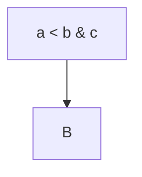
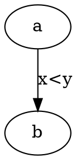

## Flow



## Graph



## Eq

```latex
E = mc^2 \quad a<b
```

## Plot

```plotly
{"data":[{"x":[0,1],"y":[1,0]}],"layout":{}}
```

## Wave

```wavedrom
{ "signal": [{ "name": "clk", "wave": "p..." }] }
```

## Raw

```html
<p>raw `tick` & "q"</p>
```
